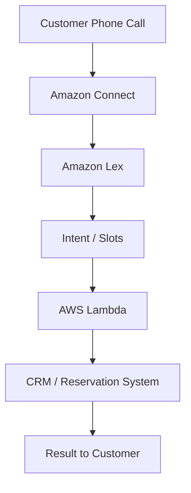
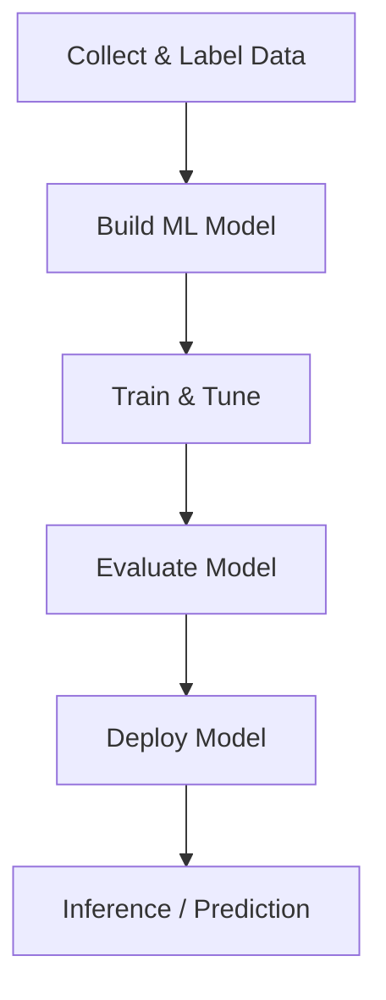

# 🤖 21-01. AWS Machine Learning Services

> AWS Certified Solutions Architect – Associate (SAA-C03)
> AWS AI/ML 서비스 및 사용 사례 정리

## 🇰🇷 1. Machine Learning Overview

**Machine Learning(ML)**은 데이터에서 패턴을 학습하고 새로운 데이터에 대한 예측이나 판단을 수행하는 기술이다.

AWS는 특정 AI 기능을 제공하는 관리형 서비스와 사용자가 직접 머신러닝 모델을 구축할 수 있는 서비스를 제공한다.

### 주요 개념

| Concept | Description |
|---|---|
| AI | 인공지능 |
| Machine Learning | 데이터를 이용한 패턴 학습 |
| Deep Learning | 신경망 기반 머신러닝 |
| NLP | Natural Language Processing, 자연어 처리 |
| NLU | Natural Language Understanding, 자연어 이해 |
| ASR | Automatic Speech Recognition, 자동 음성 인식 |
| TTS | Text-to-Speech, 음성 합성 |
| Inference | 학습된 모델을 이용한 예측·추론 |

### AWS 서비스의 두 가지 활용 방식

**1. 특정 AI 기능을 제공하는 관리형 서비스**

- Rekognition: 이미지 분석
- Transcribe: 음성 인식
- Polly: 음성 합성
- Translate: 번역
- Comprehend: 텍스트 분석
- Textract: 문서 정보 추출

**2. 직접 머신러닝 모델을 개발하는 서비스**

- Amazon SageMaker AI
- 데이터 준비, 모델 개발, 학습, 튜닝, 배포를 지원

## 🇰🇷 2. Amazon Rekognition

**이미지와 비디오를 머신러닝으로 분석하는 서비스.**

### 주요 기능

| Feature | Description |
|---|---|
| Label Detection | 객체 및 장면 탐지 |
| Text Detection | 이미지 속 문자 인식 |
| Face Detection | 얼굴 탐지 및 분석 |
| Face Comparison | 얼굴 유사도 비교 |
| Face Search | 등록된 얼굴 검색 |
| Celebrity Recognition | 유명인 얼굴 인식 |
| People Pathing | 영상 속 인물 이동 경로 분석 |
| Content Moderation | 부적절한 콘텐츠 탐지 |

### Content Moderation

이미지 또는 비디오에서 부적절하거나 원치 않는 콘텐츠를 탐지한다.

대표적인 사용 사례:

- SNS 업로드 이미지 검토
- 방송 및 광고 콘텐츠 분석
- 전자상거래 이미지 검토

**MinConfidence:** 탐지 결과를 반환할 최소 신뢰도 임계값.

- 낮은 임계값: 더 많은 레이블 반환
- 높은 임계값: 높은 신뢰도의 레이블 위주로 반환

### Architecture

```text
User Upload
     ↓
Amazon S3
     ↓
AWS Lambda
     ↓
Amazon Rekognition
     ↓
Analysis Results
```

### Human Review

Amazon Augmented AI(A2I)를 이용해 분석 결과에 사람이 검토하는 단계를 추가할 수 있었다.

현재 A2I는 신규 고객에게 제공되지 않으며 기존 고객만 이용 가능하다.

**🎯 Image / Video / Face Recognition → Rekognition**

## 🇰🇷 3. Amazon Transcribe

**음성을 텍스트로 변환하는 Speech-to-Text 서비스.**

딥러닝 기반 **ASR(Automatic Speech Recognition)** 기술을 사용한다.

```text
Audio / Speech
      ↓
Amazon Transcribe
      ↓
Text
```

### 주요 기능

- 녹음된 음성 파일의 텍스트 변환
- 실시간 음성 스트리밍 변환
- 자동 언어 식별
- 다국어 음성 인식
- PII Redaction

### PII Redaction

PII(Personally Identifiable Information)는 개인 식별 정보이다.

예시:

- 이름
- 나이
- 전화번호
- 이메일
- 사회보장번호

전사된 텍스트에서 지원되는 PII 항목을 탐지하고 가릴 수 있다.

### Use Cases

- 고객 상담 전화 기록
- 회의 녹음 텍스트화
- 영상 자막 생성
- 검색 가능한 오디오 아카이브

**🎯 Speech-to-Text / ASR / Subtitles → Transcribe**

## 🇰🇷 4. Amazon Polly

**텍스트를 자연스러운 음성으로 변환하는 Text-to-Speech 서비스.**

```text
Text
 ↓
Amazon Polly
 ↓
Audio / Speech
```

### Pronunciation Lexicon

특정 단어의 사용자 지정 발음을 등록하는 사전.

예시:

| Input | Pronunciation |
|---|---|
| St3ph4ne | Stephane |
| AWS | Amazon Web Services |

Lexicon을 등록하고 SynthesizeSpeech 요청에서 적용할 수 있다.

### SSML

**Speech Synthesis Markup Language**

음성 합성 시 발음, 일시 정지, 속도 등 읽는 방식을 제어하는 마크업 언어.

```xml
<speak>
  Hello, my name is Joanna.
  <break time="3s"/>
  I love AWS!
</speak>
```

위 예시는 첫 문장과 두 번째 문장 사이에 3초의 일시 정지를 추가한다.

일부 음성 엔진에서 지원되는 SSML 태그에는 제한이 있다.

### Lexicon vs SSML

| Lexicon | SSML |
|---|---|
| 발음 사전 | 음성 합성 마크업 |
| 단어별 발음 규칙 등록 | 문장 내 음성 표현 제어 |
| 약어·고유명사 발음 | 일시 정지·속도·발음 등 |

### Speech Engines

- Standard
- Neural
- Long-form
- Generative

**🎯 Text-to-Speech / Speech Synthesis → Polly**

## 🇰🇷 5. Amazon Translate

**자연스러운 언어 번역을 제공하는 관리형 머신러닝 서비스.**

```text
English Text
     ↓
Amazon Translate
     ↓
Japanese / Korean / French Text
```

### Use Cases

- 다국어 웹사이트
- 글로벌 모바일 애플리케이션
- 대량 텍스트 번역
- 콘텐츠 현지화(Localization)

### Related Architecture

```text
Korean Speech
      ↓
Amazon Transcribe
      ↓
Korean Text
      ↓
Amazon Translate
      ↓
Japanese Text
      ↓
Amazon Polly
      ↓
Japanese Speech
```

Transcribe는 음성을 텍스트로 변환하고, Translate는 언어를 번역하며, Polly는 텍스트를 음성으로 합성한다.

**🎯 Language Translation / Localization → Translate**

## 🇰🇷 6. Amazon Lex

**음성 또는 텍스트 기반의 대화형 챗봇을 구축하는 서비스.**

Alexa에 사용되는 기술과 관련된 서비스이며 다음 기능을 제공한다.

- ASR: 음성을 텍스트로 인식
- NLU: 사용자 발화의 의도 파악
- Intent 및 Slot 기반 대화 처리

### Intent와 Slot

사용자 발화:

"내일 오후 3시에 Tom과 미팅을 예약해 줘."

| Concept | Example |
|---|---|
| Intent | BookAppointment |
| Date Slot | Tomorrow |
| Time Slot | 3:00 PM |
| Person Slot | Tom |

- Intent: 사용자가 수행하려는 목적
- Slot: 목적을 수행하기 위해 필요한 세부 정보

필요한 정보가 누락되면 추가 질문을 하도록 구성할 수 있다.

### Use Cases

- 고객 상담 챗봇
- 예약 챗봇
- 음성 기반 고객 응대
- 주문 접수 봇

**🎯 Conversational Bot / Intent / Slot → Lex**

## 🇰🇷 7. Amazon Connect

**클라우드 기반 고객센터(Contact Center) 서비스.**

### 주요 기능

- 고객 전화 수신
- Contact Flow 구성
- 상담원 연결 및 라우팅
- 자동 음성 안내
- Lex 및 Lambda 연동
- 외부 CRM 시스템 연동

### Lex + Connect Architecture



### 서비스별 역할

| Service | Responsibility |
|---|---|
| Connect | 전화 수신 및 응대 흐름 |
| Lex | 음성 인식 및 의도 파악 |
| Lambda | 예약 등 업무 로직 실행 |
| CRM | 고객 및 예약 데이터 관리 |

Connect는 사용량 기반의 클라우드 고객센터 운영을 지원한다.

**🎯 Cloud Contact Center / Contact Flow → Connect**

## 🇰🇷 8. Amazon Comprehend

**머신러닝을 이용해 일반 텍스트를 분석하는 NLP 서비스.**

완전 관리형 서버리스 서비스이다.

### 주요 기능

| Feature | Description |
|---|---|
| Language Detection | 텍스트 언어 식별 |
| Entity Recognition | 사람, 장소, 조직 등 개체 추출 |
| Key Phrase Extraction | 핵심 문구 추출 |
| Sentiment Analysis | 감정 분석 |
| Syntax Analysis | 토큰화 및 품사 분석 |
| Topic Modeling | 문서의 주요 주제 발견 |

### Sentiment Analysis

대표적인 감정 분석 결과:

- POSITIVE: 긍정
- NEGATIVE: 부정
- NEUTRAL: 중립
- MIXED: 복합

### Use Cases

- 고객 리뷰 분석
- 고객 이메일 분석
- 서비스 불만 원인 파악
- 문서 주제 발견
- 대량 텍스트 분석

지원 언어는 Comprehend의 기능마다 다르다.

### Lex vs Comprehend

| Amazon Lex | Amazon Comprehend |
|---|---|
| 대화형 챗봇 | 텍스트 분석 |
| 사용자 의도 파악 | 감정·개체·주제 분석 |
| Intent / Slot | Sentiment / Entity / Topic |

**🎯 NLP / Sentiment Analysis / Entity Detection → Comprehend**

## 🇰🇷 9. Amazon Comprehend Medical

**비정형 의료 텍스트를 분석하는 의료 분야 특화 NLP 서비스.**

### Input Examples

- 의사 소견서
- 퇴원 요약서
- 검사 결과서
- 의료 사례 기록

### 추출 가능한 정보

- 질병과 증상
- 처방 약물
- 약물 용량 및 복용 빈도
- 검사 및 치료
- 의료 기록 관련 날짜
- 개인 건강 식별 정보

### DetectPHI API

**PHI(Protected Health Information)**는 보호 대상 건강 정보이다.

`DetectPHI` API는 의료 텍스트에서 PHI에 해당하는 개체의 종류, 위치, 신뢰도 등을 반환한다.

의료 기록에서 개인정보를 가리는 작업은 탐지 결과를 이용해 별도로 구현할 수 있다.

### Architecture

```text
Medical Documents
        ↓
Amazon S3
        ↓
Amazon Comprehend Medical
        ↓
Medical Entities / PHI
        ↓
Analysis Results
```

음성 기반 기록에는 Transcribe를 먼저 사용할 수 있다.

```text
Medical Speech
      ↓
Amazon Transcribe
      ↓
Clinical Text
      ↓
Amazon Comprehend Medical
```

**주의:** Comprehend Medical은 영어(US-EN) 의료 텍스트 분석을 지원한다.

**🎯 Medical NLP / PHI / Clinical Text → Comprehend Medical**

## 🇰🇷 10. Amazon SageMaker AI

**개발자와 데이터 과학자가 직접 ML 모델을 개발하고 학습·배포하는 관리형 서비스.**

다른 AI 서비스들이 특정 기능을 제공한다면, SageMaker AI는 사용자의 데이터와 요구사항에 맞는 모델을 구축할 수 있도록 지원한다.

### Machine Learning Lifecycle



### 시험 점수 예측 예시

| IT Experience | Course Progress | Practice Exams | Actual Score |
|---|---|---|---|
| 1 year | 100% | 5 | 890 |
| 0 years | 60% | 2 | 670 |
| 3 years | 100% | 8 | 934 |

여기서 Actual Score는 지도학습의 정답 역할을 하는 **Label**이다.

모델은 학습 데이터에서 입력 변수와 실제 점수의 관계를 학습한다.

새로운 학생의 데이터를 입력하면 예상 점수를 반환할 수 있다.

### SageMaker AI가 지원하는 작업

1. 데이터 준비 및 라벨링
2. 모델 개발
3. 모델 훈련
4. 하이퍼파라미터 튜닝
5. 모델 평가
6. 모델 배포
7. 추론(Inference)

**🎯 Custom ML Model / Training / Deployment → SageMaker AI**

## 🇰🇷 11. Amazon Forecast (Legacy)

**과거 시계열 데이터를 기반으로 미래 수치를 예측하는 관리형 ML 서비스.**

### Use Cases

- 제품 수요 예측
- 판매량 예측
- 재무 계획
- 재고 계획
- 인력 및 자원 계획

### Architecture

```text
Historical Time-Series Data
       +
Price / Discounts / Traffic
       ↓
Amazon S3
       ↓
Amazon Forecast
       ↓
Future Demand Prediction
```

예를 들어 과거 비옷 판매량과 할인 행사, 가격 등을 활용해 다음 달 판매량을 예측할 수 있다.

### Service Status

> ⚠️ Amazon Forecast는 2024-07-29부터 신규 고객에게 제공되지 않는다.
>
> 기존 고객은 계속 이용할 수 있다.
>
> 신규 구축에는 Amazon SageMaker Canvas 등 AWS가 안내하는 대안을 검토한다.

**🎯 Historical Keyword: Time-Series Forecasting → Amazon Forecast**

## 🇰🇷 12. Amazon Kendra

**머신러닝 기반의 지능형 기업 문서 검색 서비스.**

### 지원 문서 예시

- PDF
- HTML
- Microsoft Word
- PowerPoint
- FAQ
- 일반 텍스트

### 동작 원리

```text
Company Documents
        ↓
Amazon Kendra
        ↓
Document Indexing
        ↓
Natural Language Search
        ↓
Relevant Answers / Documents
```

### Example

사용자 질문:

"IT 지원 데스크는 어디에 있나요?"

검색 결과:

"1층입니다."

### 주요 기능

- 문서 인덱싱
- 자연어 검색
- 문서 내 관련 답변 추출
- 사용자 피드백 활용
- 중요도 및 최신성 기반 검색 결과 조정
- 사용자 지정 필터

### Kendra vs OpenSearch

| Kendra | OpenSearch |
|---|---|
| 지능형 기업 문서 검색 | 범용 검색 및 분석 엔진 |
| 자연어 질문 및 문서 답변 검색 | 전문 검색, 로그 분석, 검색 애플리케이션 |
| ML 기반 관리형 검색 | 검색 인덱스와 검색 기능 구성 |

**🎯 Intelligent Document Search / Knowledge Search → Kendra**

## 🇰🇷 13. Amazon Personalize

**머신러닝을 이용한 실시간 개인 맞춤형 추천 서비스.**

### Use Cases

- 쇼핑몰 상품 추천
- 음악 및 동영상 추천
- 콘텐츠 개인화
- 검색 결과 재순위화
- 맞춤형 마케팅

### Example

사용자가 원예 도구를 자주 구매했다면 관련 상품을 추천할 수 있다.

### Architecture

```text
Historical User Interactions
        ↓
Amazon S3
        ↓
Amazon Personalize
        ↑
Real-Time Interaction Events
        ↓
Recommendation API
        ↓
Website / Mobile Application
```

- 과거 구매 및 클릭 데이터를 활용한다.
- 실시간 이벤트를 수집할 수 있다.
- 사용자별 추천 결과를 API로 제공한다.
- 추천 결과를 웹사이트와 모바일 앱에 통합할 수 있다.

**🎯 Personalized Recommendations / Re-ranking → Personalize**

## 🇰🇷 14. Amazon Textract

**스캔 문서에서 텍스트, 손글씨 및 구조화된 데이터를 추출하는 서비스.**

OCR 기술과 머신러닝을 활용해 문서를 분석한다.

### 주요 기능

- 인쇄된 텍스트 추출
- 손글씨 추출
- 표(Table) 추출
- 양식(Form) 분석
- Key-Value Pair 추출
- 신분증, 송장 등 문서 분석

### Example

운전면허증이나 신청서를 분석하면 다음 정보를 추출할 수 있다.

```json
{
  "Name": "Jane Smith",
  "DateOfBirth": "1997-05-23",
  "DocumentID": "A123456"
}
```

위 JSON은 이해를 위한 개념 예시이다.

### Use Cases

- 금융: 송장 및 재무 보고서
- 의료: 의료 기록 및 보험 청구
- 공공기관: 세금 양식, 신분증, 여권

### Rekognition vs Textract

| Rekognition | Textract |
|---|---|
| 이미지·영상 내용 분석 | 문서 데이터 추출 |
| 객체·얼굴·장면 | 텍스트·표·양식 |
| 사진 분석 중심 | PDF·스캔 문서 분석 중심 |

**🎯 OCR / Scanned Documents / Forms / Tables → Textract**

## 🎯 Exam Notes

### 서비스 선택 가이드

| Requirement | AWS Service |
|---|---|
| Image / Video Analysis | Rekognition |
| Face Recognition | Rekognition |
| Content Moderation | Rekognition |
| Speech-to-Text | Transcribe |
| Audio Transcription | Transcribe |
| PII Redaction in Transcription | Transcribe |
| Text-to-Speech | Polly |
| Custom Pronunciation | Polly Lexicon |
| Speech Control | Polly SSML |
| Text Translation | Translate |
| Chatbot / Conversational AI | Lex |
| Intent / Slot Recognition | Lex |
| Cloud Contact Center | Connect |
| Text Sentiment Analysis | Comprehend |
| Natural Language Processing | Comprehend |
| Medical Text Analysis | Comprehend Medical |
| PHI Detection | Comprehend Medical |
| Custom ML Model Development | SageMaker AI |
| ML Model Training & Deployment | SageMaker AI |
| Time-Series Forecasting (Legacy) | Forecast |
| Enterprise Document Search | Kendra |
| Personalized Recommendation | Personalize |
| OCR / Forms / Tables | Textract |

### 자주 헷갈리는 서비스

**Transcribe vs Polly**

- Transcribe: Speech → Text
- Polly: Text → Speech

**Lex vs Connect**

- Lex: 대화와 의도 이해
- Connect: 고객센터와 통화 흐름 관리

**Lex vs Comprehend**

- Lex: 챗봇 대화 처리
- Comprehend: 텍스트 분석

**Comprehend vs Comprehend Medical**

- Comprehend: 일반 텍스트 NLP
- Comprehend Medical: 의료 텍스트 NLP

**Rekognition vs Textract**

- Rekognition: 이미지 내용 인식
- Textract: 문서 내용 추출

**Kendra vs Personalize**

- Kendra: 관련 문서 검색
- Personalize: 개인별 상품·콘텐츠 추천

**SageMaker AI vs 목적별 AI 서비스**

- SageMaker AI: 직접 ML 모델 개발
- 목적별 서비스: AWS가 제공하는 특정 AI 기능 사용

## 🇯🇵 日本語 Summary

### 主要サービス

| AWS Service | 主な役割 |
|---|---|
| Rekognition | 画像・動画認識 |
| Transcribe | 音声認識・文字起こし |
| Polly | テキストの音声合成 |
| Translate | 言語翻訳 |
| Lex | 対話型チャットボット |
| Connect | クラウドコンタクトセンター |
| Comprehend | 自然言語処理・感情分析 |
| Comprehend Medical | 医療テキスト分析 |
| SageMaker AI | ML モデルの開発・学習・デプロイ |
| Forecast | 時系列予測（新規顧客への提供終了） |
| Kendra | インテリジェント文書検索 |
| Personalize | パーソナライズされた推薦 |
| Textract | 文書の文字・表・フォーム抽出 |

### 重要ポイント

- **ASR:** 音声をテキストに変換する技術。
- **TTS:** テキストから音声を生成する技術。
- **NLP:** 自然言語を分析する技術。
- **NLU:** 発話の意図や意味を理解する技術。
- **Lexicon:** 単語の発音をカスタマイズする辞書。
- **SSML:** 音声合成の読み方を制御するマークアップ言語。
- **PHI:** 保護対象の健康情報。

AWS SAA 試験では、機械学習アルゴリズムの詳細よりも、要件に適したサービスを選ぶことが重要である。

## 🇺🇸 English Summary

### Main Services

- **Amazon Rekognition:** Detects objects, scenes, faces, and content in images and videos.
- **Amazon Transcribe:** Converts speech into text using ASR.
- **Amazon Polly:** Generates speech from text using TTS.
- **Amazon Translate:** Provides language translation.
- **Amazon Lex:** Builds conversational bots using ASR and NLU.
- **Amazon Connect:** Provides cloud contact center capabilities.
- **Amazon Comprehend:** Analyzes natural language, entities, sentiment, and topics.
- **Amazon Comprehend Medical:** Extracts medical information and detects PHI.
- **Amazon SageMaker AI:** Supports custom ML model development, training, tuning, and deployment.
- **Amazon Forecast:** Provides historical time-series forecasting capabilities but is closed to new customers.
- **Amazon Kendra:** Offers intelligent enterprise document search.
- **Amazon Personalize:** Provides personalized product and content recommendations.
- **Amazon Textract:** Extracts text, handwriting, forms, and tables from documents.

### Key Takeaways

1. Understand the difference between ASR, TTS, NLP, and NLU.
2. Distinguish between general-purpose ML development and purpose-built AI services.
3. Select the right service based on input data and business requirements.
4. Recognize common AWS AI/ML integration architectures.
5. Understand important service availability and support limitations.

## 📚 Vocabulary

| English | 한국어 | 日本語 |
|---|---|---|
| Machine Learning | 기계 학습 | 機械学習 |
| Deep Learning | 딥러닝 | ディープラーニング |
| Natural Language Processing | 자연어 처리 | 自然言語処理 |
| Speech Recognition | 음성 인식 | 音声認識 |
| Speech Synthesis | 음성 합성 | 音声合成 |
| Sentiment Analysis | 감정 분석 | 感情分析 |
| Entity Recognition | 개체명 인식 | 固有表現認識 |
| Text Extraction | 텍스트 추출 | テキスト抽出 |
| Model Training | 모델 학습 | モデル学習 |
| Model Deployment | 모델 배포 | モデルデプロイ |
| Inference | 추론 | 推論 |
| Recommendation | 추천 | レコメンデーション |
| Forecasting | 예측 | 予測 |
| Document Indexing | 문서 인덱싱 | 文書インデックス化 |
| Personalization | 개인화 | パーソナライゼーション |
