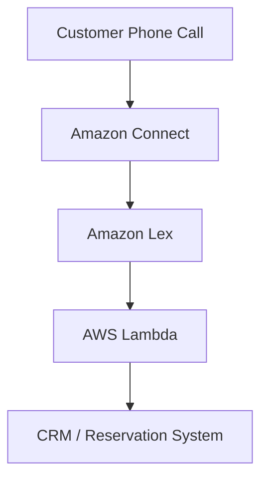

# 🤖 21. Machine Learning

> AWS Certified Solutions Architect – Associate (SAA-C03)  
> Udemy Section 23 | GitHub Section 21

## 📌 Overview

AWS는 이미지, 음성, 텍스트, 문서, 추천 시스템 등 다양한 분야에서 관리형 AI/ML 서비스를 제공한다.

이번 섹션에서는 서비스별 핵심 기능과 사용 사례를 이해하고, 요구사항에 따라 적절한 AWS 머신러닝 서비스를 선택하는 방법을 학습한다.

SAA 시험에서는 머신러닝 알고리즘의 구현보다는 **서비스의 목적과 활용 사례를 구분하는 능력**이 중요하다.

## 🎯 Learning Objectives

1. 주요 AWS AI/ML 서비스의 역할을 구분한다.
2. Speech-to-Text와 Text-to-Speech의 차이를 이해한다.
3. NLP, ASR, NLU의 개념을 이해한다.
4. Rekognition, Comprehend, Textract의 분석 대상을 구분한다.
5. Lex, Connect, Lambda를 이용한 챗봇 아키텍처를 이해한다.
6. SageMaker AI의 머신러닝 개발 과정을 이해한다.
7. 예측, 지능형 문서 검색, 개인화 추천 서비스의 사용 사례를 이해한다.

## 📂 Contents

| File | Description |
|---|---|
| [21-01-AWS-Machine-Learning-Services.md](./21-01-AWS-Machine-Learning-Services.md) | AWS AI/ML 서비스 전체 정리 및 비교 |

## 🧠 Key Concepts

| AWS Service | Main Purpose |
|---|---|
| Amazon Rekognition | Image / Video Analysis |
| Amazon Transcribe | Speech-to-Text |
| Amazon Polly | Text-to-Speech |
| Amazon Translate | Language Translation |
| Amazon Lex | Conversational Chatbot |
| Amazon Connect | Cloud Contact Center |
| Amazon Comprehend | Natural Language Processing |
| Amazon Comprehend Medical | Medical Text Analysis |
| Amazon SageMaker AI | ML Model Development & Deployment |
| Amazon Forecast | Time-Series Forecasting (Legacy) |
| Amazon Kendra | Intelligent Document Search |
| Amazon Personalize | Personalized Recommendations |
| Amazon Textract | Document Text & Data Extraction |

## 🏗️ Architecture Example

- Connect: 고객 통화 및 응대 흐름 관리
- Lex: 음성 인식과 사용자 의도 파악
- Lambda: 예약 처리 등 비즈니스 로직 실행
- CRM: 고객 데이터 및 예약 정보 관리

## ⚠️ Service Status

- **Amazon SageMaker AI:** 기존 Amazon SageMaker의 ML 모델 개발 서비스에 사용되는 명칭.
- **Amazon Forecast:** 2024-07-29부터 신규 고객에게 제공되지 않음. 기존 고객은 계속 사용 가능.
- **Amazon A2I:** 현재 신규 고객에게 제공되지 않음. 기존 고객은 계속 사용 가능.
- 일부 AI/ML 기능은 리전, 언어, 모델 및 엔진에 따른 지원 제한이 있다.

## 🎯 Exam Strategy

**Identify the business requirement first, then choose the appropriate AI/ML service.**

SAA에서는 서비스의 세부 모델 구현보다 다음과 같은 연결 관계가 중요하다.

- Speech → Text: Transcribe
- Text → Speech: Polly
- Text Translation: Translate
- Chatbot / Intent: Lex
- NLP / Sentiment: Comprehend
- Medical NLP / PHI: Comprehend Medical
- Document Extraction: Textract
- Personalized Recommendation: Personalize
- ML Model Training: SageMaker AI

---

## 🇯🇵 日本語 Summary

このセクションでは、AWS の主要な AI・機械学習サービスについて学習した。

Rekognition は画像・動画分析、Transcribe は音声認識、Polly は音声合成、Translate は言語翻訳を提供する。

Lex は対話型ボット、Connect はクラウドコンタクトセンター、Comprehend は自然言語処理に使用される。

SageMaker AI は機械学習モデルの開発・学習・デプロイを支援する。

SAA 試験では、各サービスの特徴を理解し、要件に応じて適切なサービスを選択することが重要である。

---

## 🇺🇸 English Summary

This section introduces AWS AI and machine learning services.

Rekognition analyzes images and videos. Transcribe converts speech to text, while Polly converts text to speech. Translate provides language translation.

Lex builds conversational bots, Connect provides cloud contact center capabilities, and Comprehend performs natural language processing.

SageMaker AI supports the development, training, and deployment of custom ML models.

For the SAA exam, the main objective is to select the appropriate service based on business requirements.
