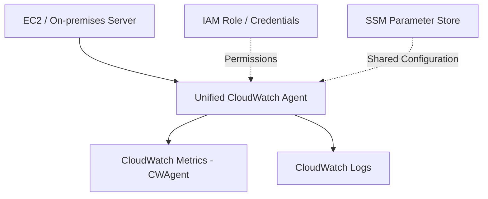

# 📘 22-01. Amazon CloudWatch Metrics & Unified CloudWatch Agent

> [!NOTE]
> **AWS SAA-C03 Study Note**  
> 핵심 키워드: `Monitoring` · `Metric` · `Namespace` · `Dimension` · `Datapoint`

## 🇰🇷 1. CloudWatch의 역할

**Amazon CloudWatch**는 AWS 애플리케이션과 인프라의 지표·로그 등을 수집하고 시각화해 운영 상태를 파악하는 모니터링 서비스이다. CloudTrail(누가 API를 호출했는가), AWS Config(설정이 어떻게 바뀌었는가)와 구분한다.

- **Metric(지표):** CPU 사용률처럼 시간에 따라 측정되는 숫자.
- **Logs(로그):** `ERROR: connection timeout`과 같은 사건의 기록. → [22-02](./22-02-CloudWatch-Logs-Fundamentals.md)
- **Alarm(경보):** 지표가 조건을 충족하면 상태 변경 및 작업 실행. → [22-04](./22-04-CloudWatch-Alarms.md)
- **Dashboard:** 여러 지표를 한 화면에서 시각화.

## 🇰🇷 2. Metrics 자료 구조

| 용어 | 의미 | 예시 |
|---|---|---|
| Namespace | 지표들을 묶는 논리적 공간 | `AWS/EC2`, `AWS/Lambda`, `CWAgent` |
| Metric Name | 측정 항목 | `CPUUtilization`, `NetworkIn`, `mem_used_percent` |
| Dimension | 지표의 대상을 지정하는 이름·값 쌍 | `InstanceId=i-0123456789abcdef0` |
| Datapoint | 특정 시간에 기록된 실제 수치 | 10:00, CPU 82% |
| Timestamp | 해당 데이터의 시각 | 2026-10-13T10:00:00Z |
| Statistic | 지표 데이터를 요약하는 방식 | Average, Sum, Minimum, Maximum, p95 |
| Resolution | 지표 데이터의 시간 해상도 | 표준 60초, 고해상도 1초 등 |

**왜 Dimension이 필요한가?** 동일한 `AWS/EC2` / `CPUUtilization` 지표가 여러 인스턴스에 존재하므로 `InstanceId`로 구분한다. Dimension은 최대 30개까지 지정할 수 있다.

**예시:** `AWS/EC2` → `CPUUtilization` → `InstanceId=i-abc` → 특정 시각의 76%.

## 🇰🇷 3. EC2 Basic vs Detailed Monitoring

| 항목 | Basic Monitoring | Detailed Monitoring |
|---|---|---|
| 일반적인 EC2 CPU 지표 주기 | **5분** | **1분** |
| 기본 제공 | 예 | 별도 활성화·추가 비용 |
| EC2 내부 RAM 사용률 | **제공하지 않음** | **제공하지 않음** |
| 목적 | 일반적인 인프라 관찰 | 더 자주 지표 수집 |

> **시험 함정:** Detailed Monitoring은 RAM/파일시스템 사용률을 자동으로 추가하지 않는다. 더 세밀한 시스템 내부 지표가 필요하면 **CloudWatch Agent**를 고려한다. 개별 기본 지표의 게시 주기는 예외가 있다.

## 🇰🇷 4. Unified CloudWatch Agent

Agent는 **EC2 또는 온프레미스 서버 내부에 설치하는 수집 프로그램**이다. 서버의 로그 파일과 시스템 지표를 읽어 AWS CloudWatch로 전송한다.



### 두 가지 Agent 구분

| 구형 CloudWatch Logs Agent | Unified CloudWatch Agent |
|---|---|
| 로그 전송 중심 | **로그 + 시스템 지표** 수집 |
| 레거시 기능 | 새로운 구축 시 일반적으로 권장 |
| 중앙 설정 기능 제한적 | **SSM Parameter Store**에 설정 저장 가능 |

### 대표 시스템 지표

- **Memory:** `mem_used_percent`, 여유 메모리, 캐시 등.
- **Disk:** 파일시스템의 총 용량·사용량·잔여 공간. `disk_used_percent`.
- **Disk I/O:** 읽기/쓰기 횟수, 바이트, IOPS.
- **CPU:** 사용자·시스템·유휴·steal 등 더 세밀한 상태.
- **Netstat / Network:** TCP·UDP 연결 상태, 패킷 등.
- **Processes:** 실행·대기·차단된 프로세스 수.
- **Swap:** 디스크를 메모리 보조 영역으로 사용하는 Swap 사용량.

**Disk Usage ≠ Disk I/O:** 전자는 저장 공간이 얼마나 찼는지, 후자는 얼마나 읽고 쓰는지를 측정한다. EBS 기본 I/O 지표와 OS 파일시스템 사용률도 구분한다.

### EC2에 설치하는 원리(영상 없이 이해하기)

1. EC2 인스턴스에 적절한 **IAM Role**을 연결한다(대표 관리형 정책: `CloudWatchAgentServerPolicy`).
2. Agent를 설치하고 설정 파일에 메모리 지표 또는 로그 파일 경로를 지정한다.
3. Agent를 실행하면 해당 정보를 CloudWatch로 전송한다.
4. 일반적으로 커스텀 Agent 지표는 `CWAgent` Namespace에서 찾는다.

권한 예: `cloudwatch:PutMetricData`, `logs:PutLogEvents`, `logs:CreateLogStream`. 실제 권한은 설정과 대상에 맞게 부여한다. 온프레미스에서는 적절한 AWS 자격 증명을 설정한다.

### Agent 설정 개념(JSON 예시)

```json
{
  "agent": {"metrics_collection_interval": 60},
  "metrics": {"metrics_collected": {"mem": {"measurement": ["mem_used_percent"]}}},
  "logs": {"logs_collected": {"files": {"collect_list": [
    {"file_path": "/var/log/myapp/app.log", "log_group_name": "MyAppLogs", "log_stream_name": "{instance_id}"}
  ]}}}
}
```

- 수집 간격: 60초 / 수집 지표: RAM 사용률 / 수집 로그: 지정된 파일.
- 파일이 실제 존재해야 하며 Agent가 읽을 권한·AWS로 전송할 권한도 필요하다.
- **SSM Parameter Store:** 여러 서버에서 같은 Agent 설정을 가져오게 할 수 있다. 설정 변경 시 Agent에 적용하는 절차는 별도 필요하다.

## 🇰🇷 5. CloudWatch Dashboards & Metric Streams

**Dashboard**는 EC2, RDS, Lambda 등의 지표를 한 화면에서 보여주는 시각화 기능이다. Region·Dimension·시간 범위를 선택할 수 있다.

**CloudWatch Metric Streams**는 지표를 지속적으로 외부 대상으로 전달한다.

```text
CloudWatch Metrics → Metric Stream → Amazon Data Firehose → S3 / Third-party Monitoring
```

- **Metric Streams:** 숫자 지표 스트리밍.
- **CloudWatch Logs Subscription:** 로그 이벤트 스트리밍. → [22-03](./22-03-CloudWatch-Logs-Analysis-and-Delivery.md)
- Metric Streams를 로그의 Metric Filter와 혼동하지 않는다.

## 🎯 Exam Notes

> [!IMPORTANT]
> SAA-C03에서 구분해야 할 핵심 포인트입니다.

| 문제 문구 | 답 |
|---|---|
| EC2 메모리(RAM) 사용률 확인 | Unified CloudWatch Agent |
| EC2 CPU 지표를 1분마다 | Detailed Monitoring |
| 인스턴스별 CPU를 구분 | Dimension `InstanceId` |
| 지표 실시간 외부 분석 파이프라인 | CloudWatch Metric Streams + Firehose |
| EC2 내부 애플리케이션 로그 수집 | CloudWatch Agent + CloudWatch Logs |

## 📝 Review Questions

> [!TIP]
> 먼저 답을 생각한 뒤 **정답 및 해설**을 펼쳐 확인하세요.

### Q1. EC2에서 CloudWatch로 RAM 사용률을 수집하고자 한다. 가장 적절한 방법은?

<details>
<summary>정답 및 해설 보기</summary>

**정답:** Unified CloudWatch Agent 설치·설정

RAM 사용률은 EC2의 기본 제공 CPU 지표가 아니다. 통합 Agent가 OS 메모리 사용량을 수집한다. Detailed Monitoring은 기본 지표 주기를 1분으로 세분화한다.

</details>

### Q2. EC2 CPUUtilization 기본 모니터링에서 일반적인 게시 간격은?

<details>
<summary>정답 및 해설 보기</summary>

**정답:** 5분

EC2 Basic Monitoring은 일반적인 CPU 지표를 5분 간격으로 게시한다. Detailed Monitoring은 1분.

</details>

### Q3. CPUUtilization이 어느 EC2 인스턴스에 속한 지표인지 구분하는 CloudWatch 구성 요소는?

<details>
<summary>정답 및 해설 보기</summary>

**정답:** Dimension: InstanceId

Namespace와 Metric 이름이 같아도 InstanceId Dimension 값에 따라 서로 다른 시계열로 구분한다.

</details>

### Q4. CloudWatch Metrics를 외부 데이터 파이프라인으로 지속적으로 내보내고 싶다. 적합한 기능은?

<details>
<summary>정답 및 해설 보기</summary>

**정답:** CloudWatch Metric Streams

Metric Streams는 숫자 지표를 Amazon Data Firehose 등을 통해 지속 전송한다. Logs Subscription은 로그 이벤트 전송.

</details>

### Q5. CloudWatch의 역할의 핵심 개념은 무엇인가?

<details>
<summary>정답 및 해설 보기</summary>

**Amazon CloudWatch**는 AWS 애플리케이션과 인프라의 지표·로그 등을 수집하고 시각화해 운영 상태를 파악하는 모니터링 서비스이다. CloudTrail(누가 API를 호출했는가), AWS Config(설정이 어떻게 바뀌었는가)와 구분한다.

</details>

## 🇯🇵 日本語 Summary

CloudWatch Metrics は CPU 使用率などの数値データを時系列で管理する。Namespace は指標の分類、Dimension はインスタンスなどの識別情報である。EC2 の詳細モニタリングは通常 1 分間隔で基本指標を送信するが、RAM 使用率を自動的に追加しない。Unified CloudWatch Agent を使用すると、メモリ・ディスク・プロセス等の詳細な指標とログを収集できる。SSM Parameter Store でエージェント設定を共有できる。

**試験の注意点:** 5分/1分は EC2 の基本メトリクスの収集間隔を意味する。CPU Credit のように別の周期を持つ指標もある。

## 🇺🇸 English Summary

CloudWatch Metrics stores time-series measurements identified by a namespace, metric name, and dimensions. EC2 detailed monitoring increases the frequency of standard metrics, but does not add memory usage automatically. The unified CloudWatch Agent collects OS-level metrics and application logs from EC2 or on-premises servers; IAM permissions are required. Metric Streams export metric data via Amazon Data Firehose.

**Exam tip:** Detailed Monitoring changes the granularity of standard EC2 metrics, while the agent adds OS-level metrics. A metric stream delivers measurements, not raw log events.

## 📚 Vocabulary

> GitHub 검색 시 영어 표제어 그대로 검색하면 관련 설명으로 이동하기 쉽다.

| English | 한국어 | 日本語 |
|---|---|---|
| Monitoring | 모니터링 | 監視（かんし） |
| Metric | 지표 | メトリクス／指標 |
| Namespace | 이름 공간 | 名前空間 |
| Dimension | 지표 구분 속성 | ディメンション |
| Datapoint | 데이터 포인트 | データポイント |
| Timestamp | 시간 기록 | タイムスタンプ |
| Resolution | 해상도 | 解像度 |
| Sampling | 샘플링 | サンプリング |
| Statistic | 통계값 | 統計値 |
| Average | 평균 | 平均 |
| Maximum | 최댓값 | 最大値 |
| Minimum | 최솟값 | 最小値 |
| Percentile | 백분위수 | パーセンタイル |
| Basic Monitoring | 기본 모니터링 | 基本モニタリング |
| Detailed Monitoring | 세부 모니터링 | 詳細モニタリング |
| CloudWatch Agent | 수집 에이전트 | CloudWatch エージェント |
| Memory Utilization | 메모리 사용률 | メモリ使用率 |
| Disk I/O | 디스크 입출력 | ディスク入出力 |
| Swap Space | 스왑 공간 | スワップ領域 |
| IAM Role | IAM 역할 | IAM ロール |
| Configuration File | 설정 파일 | 設定ファイル |
| Metric Stream | 지표 스트림 | メトリクスストリーム |
