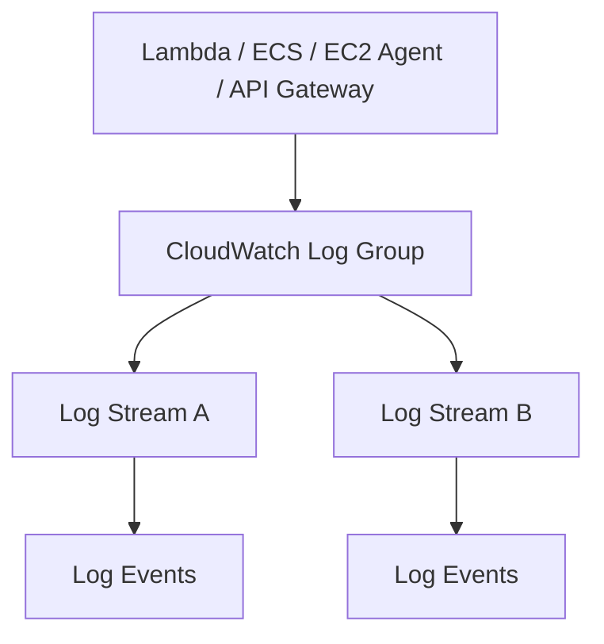

# 📜 22-02. CloudWatch Logs Fundamentals & Sources

> AWS SAA-C03 · 검색 키워드: **Log Group, Log Stream, Log Event, Retention, KMS, stdout, stderr, SSM Run Command, VPC Flow Logs**

## 🇰🇷 1. CloudWatch Logs

**CloudWatch Logs**는 서버, 컨테이너, Lambda 등에서 발생한 로그 이벤트를 중앙에 수집·보관·조회하는 서비스다.

- Metric: `CPUUtilization = 95%`처럼 **숫자로 된 상태**.
- Log: `ERROR Database connection timeout`처럼 **발생한 사건의 내용**.



## 🇰🇷 2. Log Group → Log Stream → Log Event

| 단계 | 설명 | 예시 |
|---|---|---|
| **Log Group** | 애플리케이션·서비스 단위 로그 묶음. 보존 기간/암호화 설정 단위 | `/aws/lambda/order-worker` |
| **Log Stream** | 한 인스턴스·컨테이너·로그 파일 등의 개별 로그 흐름 | `2026/10/13/[$LATEST]...` |
| **Log Event** | 타임스탬프와 메시지를 가진 로그 한 건 | `ERROR Timeout` |

**주의:** Log Group을 생성했다고 로그가 자동으로 들어오지는 않는다. 서비스의 로깅 활성화 또는 Agent 구성 등이 필요하다.

### Retention Policy

- Never expire(무기한 보관), 1일~3,653일(약 10년) 등의 보존 기간을 선택할 수 있다.
- 보존 기간이 지난 로그는 자동 삭제 대상이 된다.
- 기본적으로 저장 중 암호화되며 필요하면 고객 관리형 KMS 키를 연결할 수 있다.

## 🇰🇷 3. 로그가 들어오는 소스

| Source | 수집할 수 있는 것 | 별도 구성 관련 주의 |
|---|---|---|
| **EC2 / On-premises** | OS·애플리케이션 파일 로그 | CloudWatch Agent와 권한 필요 |
| **Lambda** | 함수 실행 메시지·예외 | CloudWatch Logs에 기록 가능, 실행 역할 권한 필요 |
| **ECS / EKS** | 컨테이너 로그 | 로깅 드라이버/Agent 등 구성 |
| **Elastic Beanstalk** | 배포 애플리케이션 로그 | 스트리밍 설정 가능 |
| **API Gateway** | API 액세스·실행 로그 | 로깅 활성화·권한 필요 |
| **VPC Flow Logs** | ENI 네트워크 흐름 메타데이터 | Flow Logs 활성화 및 대상 선택 |
| **Route 53** | DNS 쿼리 로그 | Query Logging 구성 |
| **CloudTrail** | AWS API 활동 기록 | Trail/전달 설정에 따라 CloudWatch Logs 연계 |
| **SSM Run Command** | 원격 명령 실행 출력 | CloudWatch Output 구성 가능 |

> “모든 AWS 서비스 로그가 기본 전송된다”는 뜻은 아니다. 각 서비스에서 로깅을 활성화하거나 로그 목적지를 구성해야 한다.

## 🇰🇷 4. EC2에서 직접 로그를 수집하려면?

EC2의 **기본 CloudWatch 지표**는 제공되지만, 애플리케이션 로그 파일은 자동으로 CloudWatch Logs에 올라가지 않는다.

```text
EC2: /var/log/myapp/app.log
              ↓ CloudWatch Agent
Log Group: MyAppLogs
              ↓
Log Stream: i-0123456789abcdef0
              ↓
Log Events: INFO / WARN / ERROR
```

- Agent 설치 및 파일 경로 지정.
- IAM Role에 `CloudWatchAgentServerPolicy` 등 적절한 권한 연결.
- RAM 지표 수집에도 Unified Agent를 사용할 수 있다. → [22-01](./22-01-CloudWatch-Metrics-and-Agent.md)

## 🇰🇷 5. SSM Run Command 실습 재구성

Systems Manager Run Command로 EC2 **3대에 같은 명령**을 실행했다고 가정한다.

```text
Command ID: cmd-123   (모든 서버 동일)
├── EC2-A (서로 다른 Instance ID)
│   ├── stdout: Downloading... / Installing... / Completed
│   └── stderr: errors or diagnostic messages
├── EC2-B
│   ├── stdout
│   └── stderr
└── EC2-C
    ├── stdout
    └── stderr
```

- **stdout(Standard Output):** 명령의 일반 출력.
- **stderr(Standard Error):** 오류·진단 출력을 위한 별도 통로. stderr가 사용됐다고 반드시 작업 전체가 실패한 것은 아니다.
- **Command ID:** 같은 Run Command 요청이면 동일.
- **Instance ID:** 각 실행 대상 EC2마다 다름.
- 출력이 없다면 해당 스트림이 만들어지지 않을 수도 있다.
- 로그 스트림 내부에서 `Installing`, `httpd` 등을 검색해 해당 로그 줄을 찾을 수 있다.

## 🇰🇷 6. 로그를 저장한 다음

| 목적 | 기능 | 문서 |
|---|---|---|
| 과거 로그 검색·집계 | Logs Insights | [22-03](./22-03-CloudWatch-Logs-Analysis-and-Delivery.md) |
| 들어오는 로그를 화면에서 관찰 | Live Tail | [22-03](./22-03-CloudWatch-Logs-Analysis-and-Delivery.md) |
| 로그에서 오류 횟수 지표 생성 | Metric Filter | [22-03](./22-03-CloudWatch-Logs-Analysis-and-Delivery.md) |
| 새 로그를 Lambda / Kinesis로 전달 | Subscription Filter | [22-03](./22-03-CloudWatch-Logs-Analysis-and-Delivery.md) |
| 저장한 로그를 S3로 일괄 내보내기 | Export Task | [22-03](./22-03-CloudWatch-Logs-Analysis-and-Delivery.md) |

## 🎯 Exam Triggers

- **서버 내부 로그를 중앙 수집:** CloudWatch Agent → CloudWatch Logs.
- **Log Group / Log Stream / Log Event:** 그룹 → 로그 출처별 스트림 → 개별 기록.
- **보존 기간 및 KMS 암호화:** Log Group 설정.
- **VPC 네트워크 메타데이터:** VPC Flow Logs(패킷 내용 전체가 아님).

## 📝 Review Questions

> 해당 문서의 개념을 확인하는 SAA 스타일 복습 문제. 정답은 질문 아래 **정답 및 해설**에서 확인한다.

### Q05. EC2의 /var/log/myapp/app.log 파일을 CloudWatch Logs에 전송하려고 한다. 필요한 구성은?

- A. CloudWatch Agent, 로그 수집 설정 및 IAM 권한
- B. CloudTrail Event History 조회
- C. AWS Config Rule만 설정
- D. EC2 Detailed Monitoring만 활성화

### Q06. CloudWatch Logs에서 하나의 애플리케이션 로그를 출처별로 묶는 상위 단위는?

- A. Log Event
- B. Log Stream
- C. Metric Dimension
- D. Log Group

### Q07. SSM Run Command를 3개 EC2에 동일한 Command ID로 실행했고 각각 stdout, stderr가 기록됐다. 예상 스트림 수는?

- A. 2개
- B. 3개
- C. 6개
- D. 12개

### ✅ 정답 및 해설

| 문제 | 정답 | 풀이 핵심 |
|---|---|---|
| Q05 | **A** | EC2 애플리케이션 로그 파일은 기본적으로 전송되지 않는다. Agent가 파일을 읽고 권한을 이용해 CloudWatch Logs에 전송한다. |
| Q06 | **D** | Log Group은 관련 Log Stream들을 묶고, 각 Stream 안에 Log Event가 있다. |
| Q07 | **C** | 3개 대상 × stdout/stderr 2개 = 6개. 실제 출력이 없을 때는 일부 스트림이 생성되지 않을 수 있다. |

## 📚 Vocabulary — English · 한국어 · 日本語

> GitHub 검색 시 영어 표제어 그대로 검색하면 관련 설명으로 이동하기 쉽다.

| English | 한국어 | 日本語 |
|---|---|---|
| Log Group | 로그 그룹 | ロググループ |
| Log Stream | 로그 스트림 | ログストリーム |
| Log Event | 로그 이벤트 | ログイベント |
| Log Retention | 로그 보존 기간 | ログ保持期間 |
| Standard Output (stdout) | 표준 출력 | 標準出力 |
| Standard Error (stderr) | 표준 오류 출력 | 標準エラー出力 |


## 🇯🇵 日本語 Summary

CloudWatch Logs はログを Log Group、Log Stream、Log Event の階層で管理する。EC2 のアプリケーションログを収集するには通常 CloudWatch Agent が必要である。SSM Run Command の実行結果では stdout（標準出力）と stderr（標準エラー出力）が別々のストリームになる場合がある。保存期間や暗号化は Log Group で設定する。

**試験の注意点:** EC2 のアプリケーションログは通常自動転送されない。Agent にログファイルの場所と必要な IAM 権限を設定する。

## 🇺🇸 English Summary

CloudWatch Logs collects and retains application and AWS service log events. A log group contains log streams, and each stream contains individual log events. EC2 application log files typically require the CloudWatch Agent. SSM Run Command may separate standard output (stdout) and standard error (stderr). Retention and encryption are configured at the log-group level.

**Exam tip:** EC2 log files are not shipped automatically. Configure the agent, input paths, IAM permissions, and log groups. An SSM command can generate separate stdout and stderr streams.

## 📚 References

- [CloudWatch Logs concepts](https://docs.aws.amazon.com/AmazonCloudWatch/latest/logs/CloudWatchLogsConcepts.html)
- [SSM Run Command CloudWatch output](https://docs.aws.amazon.com/systems-manager/latest/userguide/monitoring-cloudwatch-logs.html)
