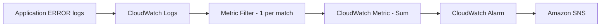
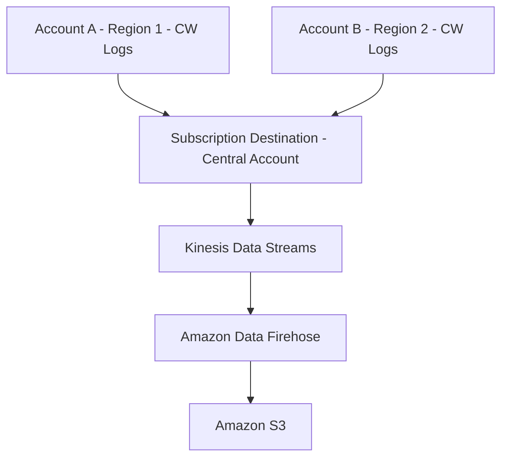

# 🔎 22-03. CloudWatch Logs Insights, Filters, Live Tail & Delivery

> AWS SAA-C03 · 검색 키워드: **Logs Insights, query, filter pattern, Metric Filter, Subscription Filter, Live Tail, CreateExportTask, S3 Export, Cross-Account Log Aggregation**

## 🇰🇷 1. 로그를 가지고 할 수 있는 네 가지 일

| 원하는 결과 | 사용하는 기능 | 결과의 형태 |
|---|---|---|
| 과거 로그를 검색·집계 | **Logs Insights** | 쿼리 결과 / 통계 / 그래프 |
| 특정 로그가 몇 번 발생했는지 숫자로 변환 | **Metric Filter** | CloudWatch Metric |
| 새 로그를 실시간에 가깝게 다른 서비스로 전달 | **Subscription Filter** | 로그 이벤트 자체 |
| 새 로그가 들어오는 모습을 즉시 관찰 | **Live Tail** | 라이브 콘솔 화면 |
| 과거 로그를 S3 파일로 일괄 전송 | **S3 Export Task** | S3 객체 |

## 🇰🇷 2. CloudWatch Logs Insights

Log Group과 시간 범위를 지정하고, Logs Insights Query Language 등을 사용해 **저장된 과거 로그를 분석**한다. 실시간 전달 엔진은 아니다.

### 최근 로그 25개

```sql
fields @timestamp, @message
| sort @timestamp desc
| limit 25
```

### ERROR가 포함된 로그 조회

```sql
fields @timestamp, @message
| filter @message like /ERROR/
| sort @timestamp desc
| limit 20
```

### 5분 단위 오류 건수 집계

```sql
filter @message like /ERROR/
| stats count(*) as errorCount by bin(5m)
```

- `fields`: 볼 필드 선택 / `filter`: 조건 적용 / `sort`: 정렬 / `limit`: 반환 수 제한 / `stats`: 집계 / `bin(5m)`: 5분 단위 그룹화.
- JSON 이벤트와 AWS 서비스 이벤트의 필드를 자동 감지할 수 있다.
- 여러 Log Group을 대상으로 쿼리할 수 있으며 적절한 Cross-Account Observability 구성이 있으면 계정 간 쿼리도 가능하다.
- 결과 차트를 CloudWatch Dashboard에 추가할 수 있다.
- **검색 결과 0건일 때:** 기간 선택을 먼저 확인한다. 지난 1시간에 없던 로그가 지난 60일에 있을 수 있다.

## 🇰🇷 3. Metric Filter: 로그 → 숫자 지표

**Metric Filter**는 새로 들어오는 로그 이벤트를 패턴과 비교해, 일치하는 이벤트를 지표 데이터로 변환한다.

예: `Installing` 문자열이 포함된 로그 하나마다 값 1 기록.

```text
Log Group
  ├─ Installing A       → +1
  ├─ Installing B       → +1
  ├─ HTTP ready         →  0
  └─ Installing C       → +1
                  Sum = 3
```

| 콘솔 항목 | 예시 |
|---|---|
| Filter Name | `DemoFilter` |
| Filter Pattern | `Installing` |
| Metric Namespace | `DemoMetricFilter` |
| Metric Name | `DemoMetric` |
| Metric Value | `1` |

- **Metric Value = 1**은 한 로그 이벤트가 일치할 때 기록할 값. 기간별 **Sum** 통계로 건수를 구한다.
- `Metric Filter`를 만든 후 수집되는 로그부터 적용한다. **과거 로그는 소급 집계되지 않는다.**
- 따라서 필터 패턴 테스트에서 기존 로그가 검색됐더라도 새 지표에 데이터가 즉시 나타나지 않을 수 있다.

### 오류 감지 자동화



자세한 Alarm 설정 → [22-04](./22-04-CloudWatch-Alarms.md).

## 🇰🇷 4. Subscription Filter: 로그 → 다른 서비스

**Subscription Filter**는 패턴에 일치하는 **로그 이벤트 그 자체**를 수집 직후 대상으로 스트리밍한다.

```text
CloudWatch Logs
  ↓ Subscription Filter (ERROR만 선택)
  ├─ AWS Lambda        (사용자 지정 로그 처리)
  ├─ Kinesis Data Streams (여러 소비자가 처리)
  └─ Amazon Data Firehose → S3 / OpenSearch 등
```

- **Metric Filter:** 건수를 지표로 바꿈.
- **Subscription Filter:** 로그 내용을 외부로 보냄.
- 로그 그룹당 구독 필터 **최대 5개**(2026 AWS CloudWatch Logs quotas 기준). 과거 슬라이드·CLI 문서에 2개라고 남아 있을 수 있다.
- 수신은 일반적으로 몇 분 이내지만 **하드 실시간 보장**과는 다르다.

### Cross-Account Logs Aggregation



- 수신 계정의 **Destination Access Policy**: 어떤 송신 계정이 전송 가능한지 제한.
- **IAM Role**: CloudWatch Logs가 실제 수신 스트림에 쓰도록 허용.
- 계정·리전별 로그를 중앙 스트림에 모을 수 있다. 실제 Cross-Region 설정과 지원 대상은 목적지 구성에 따라 확인한다.

## 🇰🇷 5. S3 Export Task: 과거 로그의 배치 내보내기

```text
CloudWatch Logs (지난달 로그)
     ↓ CreateExportTask
Amazon S3 Bucket
```

- 내보낼 시간 범위, Log Group/Stream 범위, S3 버킷·접두사를 지정한다.
- 새로 수집된 로그가 **S3 Export에 사용 가능**해지기까지 최대 12시간이 걸릴 수 있다. **작업이 반드시 12시간 이내 완료된다는 뜻이 아님.**
- **실시간/준실시간 로그 전달이 필요하면 Export 대신 Subscription Filter**를 사용한다.

## 🇰🇷 6. Live Tail: 새 로그를 화면에서 관찰

콘솔의 **Logs → Live Tail**에서 Log Group, 선택적 Log Stream, Filter Pattern을 지정하고 세션을 시작한다.

```text
DemoLogGroup → DemoLogStream → hello world 이벤트 수집
                                    ↓
                     Live Tail 화면에 거의 즉시 표시
```

- 실시간 디버깅에 유용. 실제로는 새 로그가 수집될 때 계속 표시한다.
- Logs Insights는 **과거 로그를 쿼리**하고, Live Tail은 **새로 들어오는 로그를 관찰**한다.
- 많은 로그가 들어오면 Live Tail 화면 표시가 샘플링될 수 있으므로 전체 건수 감사에는 적합하지 않다.
- 2026 AWS 요금표 예시: **월 1,800분 무료**, 초과 시 미국 요금 예시 **$0.01/분**. 불필요한 세션은 중지한다. 가격·Free Tier 적용 조건은 확인 필요.

## 🎯 Exam Decision Table

| 키워드 | 정답 |
|---|---|
| `count ERROR logs`, Alarm | Metric Filter + CloudWatch Alarm |
| `query historical logs`, `stats`, `top IP`(임의 SQL성 쿼리) | Logs Insights |
| `stream incoming logs to Lambda`, `Kinesis` | Subscription Filter |
| `near-real-time log delivery to S3` | Subscription → Firehose → S3 |
| `export last month's logs to S3` | CreateExportTask |
| `view incoming logs live` | Live Tail |

## 📝 Review Questions

> 해당 문서의 개념을 확인하는 SAA 스타일 복습 문제. 정답은 질문 아래 **정답 및 해설**에서 확인한다.

### Q08. CloudWatch Logs에 저장된 지난 60일 로그에서 ERROR를 검색하고 시간별 발생 건수를 집계하려면?

- A. CloudWatch Logs Insights
- B. CloudWatch Logs Live Tail
- C. EC2 Detailed Monitoring
- D. EventBridge Scheduler

### Q09. 새 ERROR 로그마다 값 1을 기록해 CloudWatch Alarm을 만들려 한다. 핵심 기능은?

- A. Subscription Filter
- B. Metric Filter
- C. S3 Export Task
- D. Schema Registry

### Q10. Metric Filter를 만들었지만 지난주에 저장된 ERROR 로그에 대한 지표가 즉시 보이지 않는다. 가장 타당한 이유는?

- A. Metric Filter는 새로 수집되는 로그부터 적용
- B. IAM Role은 절대 필요하지 않음
- C. CloudTrail이 비활성화됨
- D. EventBridge 버스가 없음

### Q11. CloudWatch Logs에 새로 들어오는 ERROR 로그 내용을 Lambda로 지속적으로 전달하고자 한다. 사용하는 기능은?

- A. Metric Filter
- B. Event History
- C. Subscription Filter
- D. S3 Export Task

### Q12. 지난달 CloudWatch Logs를 S3로 일괄 내보낼 때 사용하는 API는?

- A. PutMetricData
- B. SetAlarmState
- C. AssumeRole
- D. CreateExportTask

### Q13. 개발자가 서비스 실행 중 새 로그를 콘솔 화면에서 즉시 관찰하려고 한다. 기능은?

- A. Live Tail
- B. S3 Export
- C. Config Rule
- D. CloudTrail Insights

### ✅ 정답 및 해설

| 문제 | 정답 | 풀이 핵심 |
|---|---|---|
| Q08 | **A** | Logs Insights는 저장된 로그에 쿼리를 실행하며 필터, 통계, 정렬을 제공한다. Live Tail은 새 로그 관찰용이다. |
| Q09 | **B** | Metric Filter는 일치한 로그 이벤트를 숫자 지표로 변환한다. 결과 지표의 Sum을 기준으로 Alarm을 설정할 수 있다. |
| Q10 | **A** | Metric Filter는 기존 로그를 소급 집계하지 않는다. 필터 생성 이후 로그가 들어오면 지표가 만들어진다. |
| Q11 | **C** | Subscription Filter는 로그 이벤트 자체를 Lambda/Kinesis/Firehose로 전달한다. Metric Filter는 숫자로 변환한다. |
| Q12 | **D** | CreateExportTask는 지정 시간 범위의 과거 로그를 S3로 배치 내보내기 한다. 준실시간 전달에는 구독 필터가 적합하다. |
| Q13 | **A** | Live Tail은 수집되는 새 로그를 거의 실시간으로 화면에 표시한다. 필요 없으면 세션을 종료해 사용 시간을 관리한다. |

## 📚 Vocabulary — English · 한국어 · 日本語

> GitHub 검색 시 영어 표제어 그대로 검색하면 관련 설명으로 이동하기 쉽다.

| English | 한국어 | 日本語 |
|---|---|---|
| Query | 쿼리·조회문 | クエリ |
| Logs Insights | 로그 검색·분석 | Logs Insights／ログ分析 |
| Filter Pattern | 필터 패턴 | フィルターパターン |
| Metric Filter | 지표 필터 | メトリクスフィルター |
| Subscription Filter | 구독 필터 | サブスクリプションフィルター |
| Live Tail | 실시간 로그 관찰 | ライブテール |
| Export Task | 내보내기 작업 | エクスポートタスク |
| Batch Export | 일괄 내보내기 | バッチエクスポート |
| Near Real-Time | 준실시간 | ほぼリアルタイム |
| Subscription Destination | 구독 목적지 | サブスクリプション宛先 |
| Cross-Account Aggregation | 계정 간 통합 | クロスアカウント集約 |


## 🇯🇵 日本語 Summary

Logs Insights は過去のログを検索・集計するクエリエンジン。Metric Filter はログの一致件数などを数値指標に変換し、CloudWatch Alarm と組み合わせる。Subscription Filter はログイベントそのものを Lambda、Kinesis、Firehose などに送る。Live Tail は新着ログをリアルタイムに近い形で画面に表示する。S3 Export はバッチ処理であり、リアルタイム転送ではない。

**試験の注意点:** フィルターを作る前のログは Metric Filter によって遡及集計されない。S3 Export はバッチ処理、Subscription は継続配信である。

## 🇺🇸 English Summary

Use Logs Insights to query stored log data. A metric filter converts matching new log events into numerical metrics; a subscription filter forwards matching log events to other services. Live Tail displays incoming logs for interactive debugging. `CreateExportTask` exports historical logs to S3 in batches, not in real time. Cross-account subscriptions can centralize logs using a destination, permissions, and a Kinesis stream.

**Exam tip:** Metric filters count newly ingested matching events; subscriptions forward raw events; Insights queries stored events; Live Tail watches incoming events; Export Task sends historical batches to S3.

## 📚 References

- [CloudWatch Logs subscription filters](https://docs.aws.amazon.com/AmazonCloudWatch/latest/logs/Subscriptions.html)
- [CloudWatch Logs quotas](https://docs.aws.amazon.com/AmazonCloudWatch/latest/logs/cloudwatch_limits_cwl.html)
- [CloudWatch Logs filter patterns](https://docs.aws.amazon.com/AmazonCloudWatch/latest/logs/FilterAndPatternSyntax.html)
- [CloudWatch pricing, Live Tail](https://aws.amazon.com/cloudwatch/pricing/)
