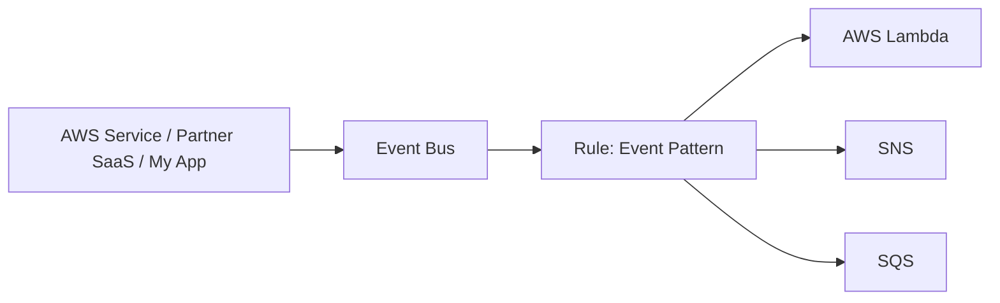
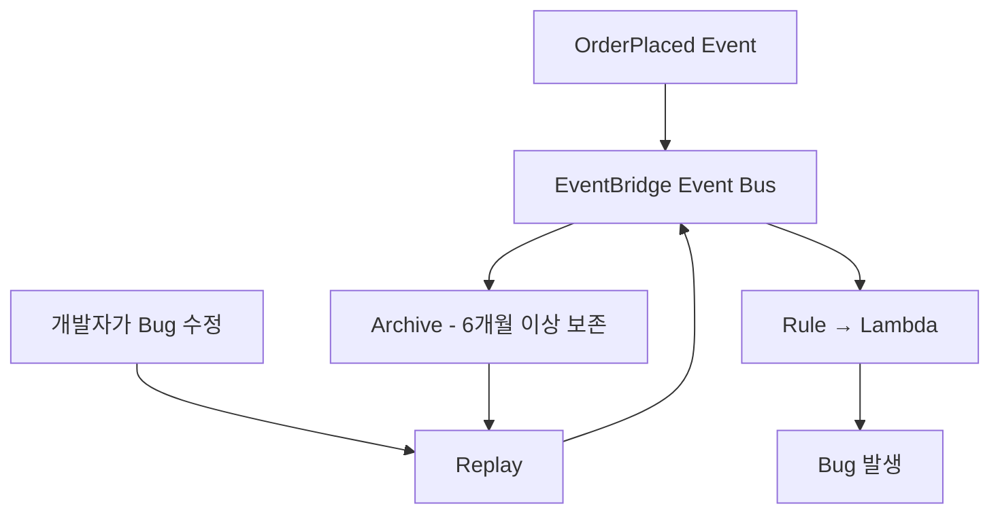

# ⚡ 22-05. Amazon EventBridge: Events, Rules, Scheduler & Replay

> AWS SAA-C03 · 검색 키워드: **CloudWatch Events, EventBridge Rule, Event Bus, Event Pattern, Target, Scheduler, Cron, Rate, Partner Event Bus, Custom Event Bus, Archive, Replay, Schema Registry, PutEvents, Cross-Account**

## 🇰🇷 1. EventBridge의 정의

**Amazon EventBridge**는 AWS 서비스, 외부 SaaS, 자체 애플리케이션 등의 **이벤트를 수신하고**, 규칙(Rule)에 따라 지정된 대상(Target)으로 전달하는 이벤트 기반 라우팅 서비스이다. **CloudWatch Events**는 예전 명칭으로, EventBridge는 이를 확장한 서비스이다.



| 용어 | 설명 | 예시 |
|---|---|---|
| **Event** | 발생한 사실과 부가정보를 담은 JSON 문서 | EC2가 `stopped`로 변경 |
| **Event Bus** | 이벤트를 받는 통로 | 기본 `default` 버스 |
| **Rule** | 이벤트가 어떤 조건을 충족해야 하는지 판단 | EC2 상태가 `stopped` 또는 `terminated` |
| **Target** | 조건에 일치하면 실행할 서비스 | SNS, Lambda, SQS, Step Functions 등 |

## 🇰🇷 2. AWS 서비스 이벤트 감지 실습

**요구사항:** EC2 인스턴스가 **중지 완료(stopped)** 또는 **종료 완료(terminated)** 되면 SNS로 이메일 알림.

1. EventBridge → Rules → Create Rule.
2. 이름: `DemoRuleEventBridge` / 이벤트 버스: `default`.
3. 이벤트 소스: AWS Services → EC2 → EC2 Instance State-change Notification.
4. Event Pattern에 상태 두 개 선택.
5. Target: SNS Topic `demo-topic` (이메일 구독 확인 필요).
6. EC2를 실제 중지하거나 종료하면 상태 변경 이벤트가 전달될 수 있다.

### 실제 Event Pattern(JSON)

```json
{
  "source": ["aws.ec2"],
  "detail-type": ["EC2 Instance State-change Notification"],
  "detail": {"state": ["stopped", "terminated"]}
}
```

`stopping`은 중지 **진행 중**, `stopped`는 중지 **완료**이므로 혼동하지 않는다. `pending`, `running`은 이 규칙과 일치하지 않는다.

### EventBridge Sandbox

- **Rule을 생성하기 전에**, 샘플 JSON Event를 주고 Event Pattern과 일치하는지 시험하는 화면.
- 시험 키워드: **Test event pattern / Sample event → EventBridge Sandbox**.

## 🇰🇷 3. 이벤트 JSON 구조

```json
{
  "version": "0",
  "id": "example-event-id",
  "source": "aws.ec2",
  "detail-type": "EC2 Instance State-change Notification",
  "account": "111122223333",
  "region": "ap-northeast-1",
  "time": "2026-10-13T09:00:00Z",
  "detail": {"instance-id": "i-example", "state": "stopped"}
}
```

- `source`: 서비스 / `detail-type`: 이벤트 이름 / `detail`: 상세 정보.
- JSON의 값을 Rule에서 필터링하며, 여러 Rule이 하나의 이벤트를 처리할 수도 있다.

## 🇰🇷 4. Scheduler: 시간 기준 실행

이벤트 패턴은 **사건이 발생할 때**, Scheduler는 **지정한 시간이 됐을 때** 실행한다.

| 방식 | 예시 | 의미 |
|---|---|---|
| Rate | `rate(1 hour)` | 일정한 간격으로 실행 |
| Cron | `cron(0 9 ? * MON *)` | 매주 월요일 오전 9시(시간대 설정에 유의) |

```text
EventBridge Scheduler → Lambda → 매시간 데이터 정리
```

**2026 기준:** Scheduled Rule은 레거시 방식이다. AWS는 예약 실행 용도로 **EventBridge Scheduler**를 권장한다. Scheduler는 일회성·반복 예약, 시간대, 재시도 설정 등을 지원한다.

## 🇰🇷 5. 이벤트 버스 유형

| 버스 | 이벤트 출처 | 예시 |
|---|---|---|
| **Default** | AWS 서비스 이벤트 및 CloudTrail 경유 이벤트 | EC2 상태 변경, AWS API 활동 |
| **Partner** | 지원되는 외부 SaaS 파트너 | Zendesk, Auth0 등의 연동 이벤트 |
| **Custom (Classic)** | 자체 애플리케이션 및 다른 계정의 이벤트 | `OrderPlaced`, `PaymentConfirmed` |

**Custom event 예시:** 쇼핑몰 주문 시스템이 `PutEvents`로 `OrderPlaced` 이벤트를 Event Bus에 발행하면 규칙이 Lambda(재고), SQS(배송), SNS(알림)로 분배한다. 서비스 간 직접 호출을 줄이는 **느슨한 결합(Loose Coupling)** 아키텍처가 된다.

> 최신 EventBridge는 일부 **새 Custom Event Bus / Subscribers** 경험도 제공한다. Udemy 강의의 Event Bus/Rule/Target 구조는 기존 Classic Bus 개념에 해당한다. 시험에서는 기본 EventBridge Rule 흐름을 우선 숙지한다.

## 🇰🇷 6. Archive & Replay

Archive는 지정된 이벤트를 **미리 저장**하고, Replay는 아카이브된 이벤트를 **원래 소스 Event Bus로 다시 보내는 기능**이다.



- 사용 사례: 6개월마다 과거 이벤트로 회귀 테스트, 장애 복구, 버그 수정 후 재처리.
- 이벤트는 자동으로 아카이브되는 것이 아니라 **아카이브 구성**이 필요하다.
- 보존 기간은 필요 기간보다 충분히 길게 지정한다.
- Replay는 최초 이벤트와 동일한 순서로 전달된다고 보장되지 않는다.
- **멱등성(Idempotency)** 고려: 이벤트를 재처리해도 결제·주문이 중복되지 않도록 설계해야 한다.

## 🇰🇷 7. Schema Registry & Schema Discovery

**Schema**는 이벤트 데이터의 필드와 타입 구조를 기술하는 설계도다.

```json
{"orderId": "ORDER-123", "amount": 50000}
```

- `orderId`: String, `amount`: Number.
- **Schema Discovery:** Event Bus에서 관찰한 이벤트를 바탕으로 스키마를 추론.
- **Schema Registry:** 추론·등록된 스키마 보관 및 버전 관리.
- **Code Bindings:** 지원 언어용 데이터 구조 코드를 자동 생성해 개발자의 오류를 줄이는 데 활용.
- 시험 연결: **이벤트 JSON의 구조를 자동으로 파악하고 코드를 생성 → Schema Registry / Discovery**.

## 🇰🇷 8. Cross-Account Event Bus & Resource-Based Policy

다른 AWS 계정의 이벤트를 중앙 계정으로 모을 수 있다.

```text
Account A ─ PutEvents ─┐
                       ├→ Central Event Bus (Account C) → Rule → SNS
Account B ─ PutEvents ─┘
```

- **Resource-Based Policy(중앙 버스에 부착):** 누가 이 Event Bus에 `events:PutEvents`를 수행할 수 있는지 제한한다.
- **송신 IAM 권한:** 이벤트를 보내는 주체도 적절한 권한이 있어야 한다.
- AWS Organizations를 조건으로 사용하는 중앙 거버넌스 구성도 가능하다.

## 🇰🇷 9. CloudTrail과 결합하기: API 호출 감지

**상태 변경 이벤트**와 **API 호출 이벤트**는 구별한다.

- **EC2가 중지 완료됨:** EC2 서비스가 직접 EventBridge로 상태 변경 이벤트를 보낼 수 있다.
- **누군가 `DeleteTable` API 호출:** CloudTrail 이벤트(`AWS API Call via CloudTrail`)를 EventBridge Rule로 필터링한다.

```json
{
  "source": ["aws.dynamodb"],
  "detail-type": ["AWS API Call via CloudTrail"],
  "detail": {
    "eventSource": ["dynamodb.amazonaws.com"],
    "eventName": ["DeleteTable"]
  }
}
```

**중요:** CloudTrail에서 EventBridge로 API 이벤트를 전달하려면 **로깅이 활성화된 Trail**이 필요하다. 단순히 기본 Event History가 있다는 것만으로 충분하지 않다. AWS 이벤트 전송은 서비스에 따라 Best Effort이고 모든 API 호출이 100% EventBridge로 전달되는 것은 아니다. Read-only 관리 이벤트는 추가 Rule State 설정이 요구된다.

기타 예시: `sts.amazonaws.com` / `AssumeRole`(STS API), `ec2.amazonaws.com` / `AuthorizeSecurityGroupIngress`(보안 그룹 인바운드 규칙 허용).

## 🎯 Exam Notes

| 요구사항 | 선택 |
|---|---|
| 어떤 AWS 상태 변경에 반응해 Lambda | EventBridge Rule |
| 매시간 Lambda 실행 | EventBridge Scheduler |
| 외부 SaaS 이벤트 처리 | Partner Event Bus |
| 자체 앱의 주문 이벤트 분배 | Custom Event Bus |
| 과거 이벤트 재사용, 회귀 테스트 | Archive & Replay |
| 이벤트 구조 추론 및 코드 바인딩 | Schema Registry |
| 여러 계정 이벤트 중앙 처리 | Resource-Based Policy + Cross-Account Bus |
| 특정 API 호출 시 SNS 알림 | CloudTrail Trail + EventBridge Rule + SNS |

## 📝 Review Questions

> 해당 문서의 개념을 확인하는 SAA 스타일 복습 문제. 정답은 질문 아래 **정답 및 해설**에서 확인한다.

### Q19. EC2가 stopped 상태가 되었을 때 SNS를 실행하려 한다. 적절한 구조는?

- A. CloudTrail만 생성
- B. EventBridge 상태 변경 Rule → SNS
- C. Config Rule → IAM
- D. Metrics Stream → CloudTrail

### Q20. 매주 월요일 오전 9시 Lambda를 자동 실행할 현재 권장 AWS 기능은?

- A. EventBridge Scheduler
- B. EventBridge Archive
- C. CloudTrail Insights
- D. Config Resource Timeline

### Q21. 회사가 6개월 뒤 테스트를 위해 과거 이벤트를 다시 처리해야 한다. 가장 적합한 기능은?

- A. CloudWatch Logs Live Tail
- B. Config Aggregator
- C. EventBridge Archive & Replay
- D. EC2 Reboot

### Q22. 여러 AWS 계정이 중앙 계정의 Event Bus에 PutEvents로 이벤트를 보내려 한다. 핵심 수신 측 권한은?

- A. S3 Versioning
- B. EC2 Security Group
- C. CloudWatch Agent
- D. Event Bus Resource-Based Policy

### Q23. CloudTrail의 AWS API Call via CloudTrail 이벤트를 EventBridge에서 감지하려면?

- A. Event History만 기본 활성화돼 있으면 모든 API가 완전 전달
- B. 로깅이 활성화된 CloudTrail Trail 및 적절한 이벤트 설정
- C. EC2 Detailed Monitoring
- D. S3 Object Lock만 설정

### ✅ 정답 및 해설

| 문제 | 정답 | 풀이 핵심 |
|---|---|---|
| Q19 | **B** | EC2 상태 변경 이벤트는 EventBridge로 직접 전달될 수 있다. Rule로 stopped 상태를 필터링한다. |
| Q20 | **A** | Scheduler는 Cron/Rate 시간 기준 반복 예약을 지원한다. 기존 Scheduled Rule은 레거시이다. |
| Q21 | **C** | Archive에서 이벤트를 일정 기간 보관하고 Replay로 다시 원래 Event Bus에 전송한다. 사전 아카이빙과 보존 기간 설정이 필요하다. |
| Q22 | **D** | 중앙 Event Bus의 Resource-Based Policy가 외부 계정의 PutEvents를 허용해야 하며 송신 측 IAM 권한도 필요하다. |
| Q23 | **B** | AWS 공식 안내에 따라 CloudTrail API 이벤트용 EventBridge 전달에는 로깅 중인 Trail이 필요하다. 모든 API의 완전 전달은 보장되지 않는다. |

## 🇯🇵 日本語 Summary

Amazon EventBridge はイベント駆動型アーキテクチャを実現するサービス。Event Bus でイベントを受信し、Rule が JSON の Event Pattern と照合して Target（Lambda、SNS、SQS など）へ送る。定期実行には EventBridge Scheduler を使用する。Default / Partner / Custom のイベントバスを区別する。Archive & Replay は過去のイベントを保存・再配信する。Schema Registry はイベント構造とバージョンを管理する。別アカウントからの受信にはリソースベースポリシーを使用する。

**試験の注意点:** API 呼び出しの監視と EC2 の状態変更イベントは別物。時間指定の実行には Scheduler、過去のイベント再配信には Archive & Replay を使う。

## 🇺🇸 English Summary

EventBridge routes JSON events from AWS services, SaaS partners, and custom applications through event buses, rules, and targets. Use Scheduler for time-based invocations. Archive & Replay stores events for later reprocessing; Schema Registry describes event structures. Resource-based policies enable cross-account publishing. AWS API call events via CloudTrail require a logging trail and are not guaranteed to be delivered with perfect completeness.

**Exam tip:** EventBridge routes matching events rather than storing audit history. Use Scheduler for time-based automation, Archive & Replay for historical events, and bus policies for cross-account publishing.

## 📚 Vocabulary

> GitHub 검색 시 영어 표제어 그대로 검색하면 관련 설명으로 이동하기 쉽다.

| English | 한국어 | 日本語 |
|---|---|---|
| Event | 이벤트·사건 | イベント |
| Event Bus | 이벤트 버스 | イベントバス |
| Rule | 규칙 | ルール |
| Event Pattern | 이벤트 조건 패턴 | イベントパターン |
| Target | 대상 서비스 | ターゲット |
| Scheduler | 예약 실행기 | スケジューラー |
| Cron Expression | 크론 예약 표현식 | Cron 式 |
| Rate Expression | 주기 표현식 | Rate 式 |
| Partner Event Bus | 파트너 이벤트 버스 | パートナーイベントバス |
| Custom Event Bus | 사용자 지정 이벤트 버스 | カスタムイベントバス |
| Archive | 이벤트 보관 | アーカイブ |
| Replay | 이벤트 재생 | リプレイ |
| Schema Registry | 스키마 레지스트리 | スキーマレジストリ |
| Schema Discovery | 스키마 자동 탐색 | スキーマ検出 |
| Code Bindings | 코드 바인딩 | コードバインディング |
| Resource-Based Policy | 리소스 기반 정책 | リソースベースポリシー |
| PutEvents | 이벤트 게시 API | イベント送信 API |
| Loose Coupling | 느슨한 결합 | 疎結合（そけつごう） |
| Idempotency | 멱등성 | 冪等性（べきとうせい） |

## 📚 Official References

- [EventBridge Rules](https://docs.aws.amazon.com/eventbridge/latest/userguide/eb-rules.html)
- [Scheduling legacy rules vs Scheduler](https://docs.aws.amazon.com/eventbridge/latest/userguide/eb-scheduled-rule-pattern.html)
- [CloudTrail events delivered to EventBridge](https://docs.aws.amazon.com/eventbridge/latest/userguide/eb-service-event-cloudtrail.html)
- [Read-only CloudTrail events](https://docs.aws.amazon.com/eventbridge/latest/userguide/eb-service-event-cloudtrail-management.html)
