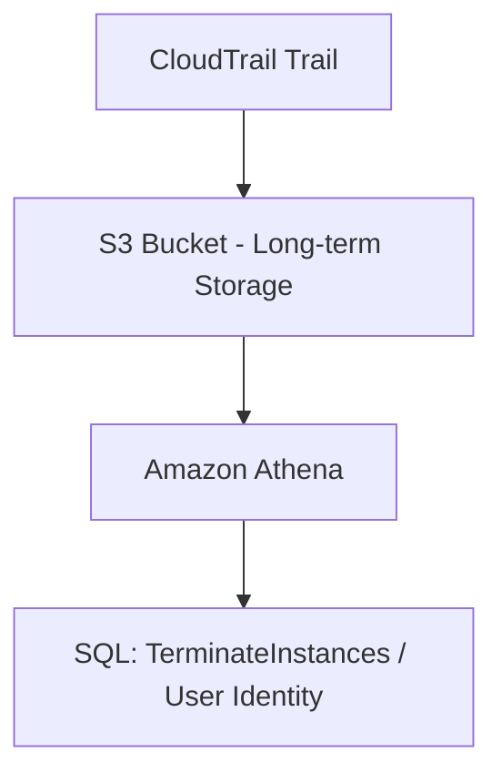

# 📘 22-07. AWS CloudTrail: API Audit, Event History & Insights

> [!NOTE]
> **AWS SAA-C03 Study Note**  
> 핵심 키워드: `Audit` · `Governance` · `Management Event` · `Data Event` · `Insights Event`

## 🇰🇷 1. CloudTrail이란?

**AWS CloudTrail**은 AWS 계정의 API 활동과 지원되는 계정 활동을 기록하는 감사(Audit) 서비스다. 콘솔 버튼 클릭도 내부적으로 AWS API 호출로 이어질 수 있다.

**대표 질문:** “누가, 언제, 어느 IP/리전에서, 어떤 AWS API를 호출해 EC2를 종료했는가?”

```text
User / AWS CLI / SDK / Service
                  ↓ API Calls
              AWS CloudTrail
                  ├→ Event History: 최근 90일 관리 이벤트
                  └→ Trail → S3 (장기 저장) → Amazon Athena
```

- User identity, Event Name, Event Time, Source IP, Region, Request Parameters 등을 조사한다.
- 예: `TerminateInstances`, `DeleteTable`, `AttachRolePolicy`, `AuthorizeSecurityGroupIngress`.
- CloudWatch는 성능 지표, Config는 설정 변화와 준수 상태: [22-09 비교](./22-09-Comparison-and-Architecture-Patterns.md).

## 🇰🇷 2. Event History vs Trail

| 구분 | Event History | Trail |
|---|---|---|
| 기본 제공 | 자동으로 사용 가능 | 직접 생성·설정 |
| 기본 조회 내용 | 최근 **90일 Management Events** | 선택한 이벤트를 S3로 지속 전달 |
| 검색 범위 | 계정 + 리전 기준 | Multi-Region 및 Organization Trail 구성 가능 |
| Data Events 기본 포함 | **아니오** | 선택·활성화 필요 |
| 90일 초과 감사 기록 | Event History 단독으로 불가 | S3에 장기 보관 가능 |

**시험 함정:** “CloudTrail은 기본 활성화”란 **Event History**가 기본 제공된다는 뜻. 별도 Trail을 자동으로 생성해 S3에 장기 보관한다는 뜻은 아니다.

## 🇰🇷 3. CloudTrail 이벤트 유형

강의는 3개(Management / Data / Insights)를 소개하지만, **2026 공식 문서에는 Network Activity Events까지 포함해 4종류**가 있다.

| 이벤트 유형 | 무엇을 감시하나 | 대표 예시 | 기본 수집 |
|---|---|---|---|
| **Management Events** | 리소스 관리·제어 영역 활동 | EC2 종료, IAM 정책 연결, 서브넷 생성 | Event History에 기록 |
| **Data Events** | 개별 리소스 데이터에 대한 고빈도 작업 | S3 `GetObject`, `PutObject`, `DeleteObject`; Lambda `Invoke` | 별도 활성화 |
| **Insights Events** | 평소와 달라진 API 호출 비율·오류율 | API 요청 급증·예외 패턴 | 별도 활성화/비용 |
| **Network Activity Events** | 지원되는 VPC Endpoint 경유 AWS API 네트워크 활동 | VPC 엔드포인트를 경유한 AWS API 요청 | 별도 활성화 |

### Management Events의 Read / Write

- **Read:** `DescribeInstances`, `ListUsers` 등 상태를 변경하지 않는 조회.
- **Write:** `TerminateInstances`, `DeleteTable`, `AttachRolePolicy` 등 상태 변경/수정.

### Data Events의 Read / Write

- **Read:** S3 `GetObject`.
- **Write:** S3 `PutObject`, `DeleteObject`.

**S3 `CreateBucket`은 Management Event이고, `PutObject`는 Data Event.** 이것만 확실히 구별해도 자주 나오는 문제를 풀 수 있다.

## 🇰🇷 4. CloudTrail Insights

**평소 활동의 기준선(Baseline)**과 실제 API 사용 패턴을 비교해 비정상적인 변화(요청률·오류율)를 감지한다.

- 이상 패턴 예: API 호출 급증, 실패율 급증, 비정상적인 관리 작업 변화.
- 사용하려면 별도 설정과 추가 비용이 필요하다.
- Insights 이벤트를 S3/이벤트 처리 파이프라인에서 활용할 수 있다.
- “모든 악성 사용자나 침해를 확정 진단한다”는 뜻은 아니다.

## 🇰🇷 5. Event History 실습 재구성

1. EC2 콘솔에서 `DemoInstance`를 Terminate한다.
2. 몇 분 뒤 CloudTrail → Event History로 이동한다.
3. Event Name=`TerminateInstances`를 검색한다.
4. 이벤트 세부 내용에서 IAM 사용자/역할, 시각, 리전, 호출 IP, 요청 파라미터를 본다.

```json
{
  "eventSource": "ec2.amazonaws.com",
  "eventName": "TerminateInstances",
  "awsRegion": "ap-northeast-1",
  "sourceIPAddress": "192.0.2.10"
}
```

위 JSON은 구조 설명을 위한 축약 예시다. 실제 CloudTrail 이벤트에는 `userIdentity`, `requestParameters` 등의 정보가 포함될 수 있다.

## 🇰🇷 6. 90일 초과 보관: S3 & Athena



- Trail에서 S3 저장 대상으로 설정한다.
- 기간과 보존 정책을 지정하여 장기 보관한다.
- Athena로 S3 로그를 SQL 분석할 수 있다.
- 필요하다면 CloudWatch Logs로도 기록을 전달할 수 있다.
- **CloudTrail Lake / Event Data Store** 역시 이력·분석과 관련된 용어. 기능/신규 이용 가능성은 2026년 현재 상태를 별도 확인하며, 강의의 S3 + Athena 구조를 우선 이해한다.

## 🇰🇷 7. CloudTrail + EventBridge + SNS

특정 **API 호출 자체**를 알림의 조건으로 사용할 때는 EventBridge에 CloudTrail 경유 이벤트가 전달되도록 설정할 수 있다.

```text
DynamoDB DeleteTable API → CloudTrail Trail (Logging ON)
                         → EventBridge Rule: eventName=DeleteTable
                         → SNS → Email
```

**중요한 실무 조건:**

- `AWS API Call via CloudTrail` 이벤트는 **CloudTrail Trail에서 로깅 활성화 필요**(Event History만으로는 충분하지 않음).
- CloudTrail 경유 EventBridge 이벤트는 **Best Effort** 방식이며 모든 API 호출의 실시간 알림을 100% 보장하지 않는다.
- 지원되지 않는 이벤트 유형이 있거나 Data Event를 요구하면 Trail에서 이벤트 선택 설정을 확인한다.
- EC2의 **상태 변경 자체**는 서비스가 EventBridge로 직접 이벤트를 보낼 수 있으므로, API 호출 감지와 구별한다.

EventBridge의 Rule 예시 및 추가 조건 → [22-05](./22-05-Amazon-EventBridge.md).

## 🎯 Exam Notes

> [!IMPORTANT]
> SAA-C03에서 구분해야 할 핵심 포인트입니다.

| 문제 키워드 | 답 |
|---|---|
| `Who deleted EC2?`, `who invoked API?` | CloudTrail Event History / Trail |
| `S3 Object access audit` | Data Events 활성화 |
| `API call volume anomaly` | CloudTrail Insights |
| `90+ days audit retention` | Trail → S3 (또는 지원되는 이벤트 데이터 스토어 방식) |
| `CloudTrail logs SQL query` | Amazon Athena on S3 logs |
| `API DeleteTable triggers SNS` | Trail + EventBridge Rule + SNS |

## 📝 Review Questions

> [!TIP]
> 먼저 답을 생각한 뒤 **정답 및 해설**을 펼쳐 확인하세요.

### Q1. 누가 EC2의 TerminateInstances API를 호출했는지 조사하려 한다. 무엇을 확인하나?

<details>
<summary>정답 및 해설 보기</summary>

**정답:** CloudTrail Event History

CloudTrail은 AWS 계정의 API 활동 감사 기록이다. Event History는 최근 90일의 관리 이벤트를 조회한다.

</details>

### Q2. S3 객체 GetObject API 액세스 감사가 필요하다. CloudTrail에서 어떤 이벤트를 활성화해야 하나?

<details>
<summary>정답 및 해설 보기</summary>

**정답:** Data Events

객체 GetObject/PutObject/DeleteObject는 Data Events에 속하고 기본으로 기록되지 않으므로 별도 활성화한다.

</details>

### Q3. CloudTrail의 최근 90일 Event History에 기본적으로 포함되는 이벤트는?

<details>
<summary>정답 및 해설 보기</summary>

**정답:** Management Events

Event History의 기본 범위는 리전별 최근 90일 Management Events이다. 모든 유형이 90일 저장된다는 뜻은 아니다.

</details>

### Q4. CloudTrail이란?의 핵심 개념은 무엇인가?

<details>
<summary>정답 및 해설 보기</summary>

**AWS CloudTrail**은 AWS 계정의 API 활동과 지원되는 계정 활동을 기록하는 감사(Audit) 서비스다. 콘솔 버튼 클릭도 내부적으로 AWS API 호출로 이어질 수 있다.

</details>

### Q5. Event History vs Trail의 핵심 개념은 무엇인가?

<details>
<summary>정답 및 해설 보기</summary>

**시험 함정:** “CloudTrail은 기본 활성화”란 **Event History**가 기본 제공된다는 뜻. 별도 Trail을 자동으로 생성해 S3에 장기 보관한다는 뜻은 아니다.

</details>

## 🇯🇵 日本語 Summary

CloudTrail は AWS アカウント内の API 操作を監査するサービス。「誰が・いつ・何をしたか」を追跡する。Event History はリージョンごとの直近 90 日間の管理イベントを表示する。S3 への長期保存には Trail を設定する。Management Events は設定操作、Data Events は S3 オブジェクトなどに対する操作、Insights Events は API 利用の異常、Network Activity Events は対応するネットワーク経路の API 活動を表す。EventBridge との API 連携にはログ記録中の Trail が必要である。

**試験の注意点:** デフォルトの Event History は90日分の Management Events のみ。S3 GetObject の監査には Data Events を明示的に記録する。

## 🇺🇸 English Summary

CloudTrail provides AWS account activity and API auditing: who performed which action and when. Event History includes 90 days of regional management events, while a trail delivers chosen events to S3 for longer retention. Management, data, Insights, and network activity are distinct event types. Configure data-event logging separately. An active logging trail is required to receive `AWS API Call via CloudTrail` events in EventBridge.

**Exam tip:** Do not confuse Event History with a trail. Event History is a regional 90-day management-event view; a trail can deliver selected event types to S3.

## 📚 Vocabulary

> GitHub 검색 시 영어 표제어 그대로 검색하면 관련 설명으로 이동하기 쉽다.

| English | 한국어 | 日本語 |
|---|---|---|
| Audit | 감사 | 監査 |
| Governance | 거버넌스 | ガバナンス |
| Management Event | 관리 이벤트 | 管理イベント |
| Data Event | 데이터 이벤트 | データイベント |
| Insights Event | 이상 활동 탐지 이벤트 | Insights イベント |
| Network Activity Event | 네트워크 활동 이벤트 | ネットワークアクティビティイベント |
| Event History | 이벤트 기록 | イベント履歴 |
| Trail | 지속 이벤트 전달 설정 | 証跡（トレイル） |
| Anomaly Detection | 이상 탐지 | 異常検知 |
| Baseline | 기준선 | ベースライン |
