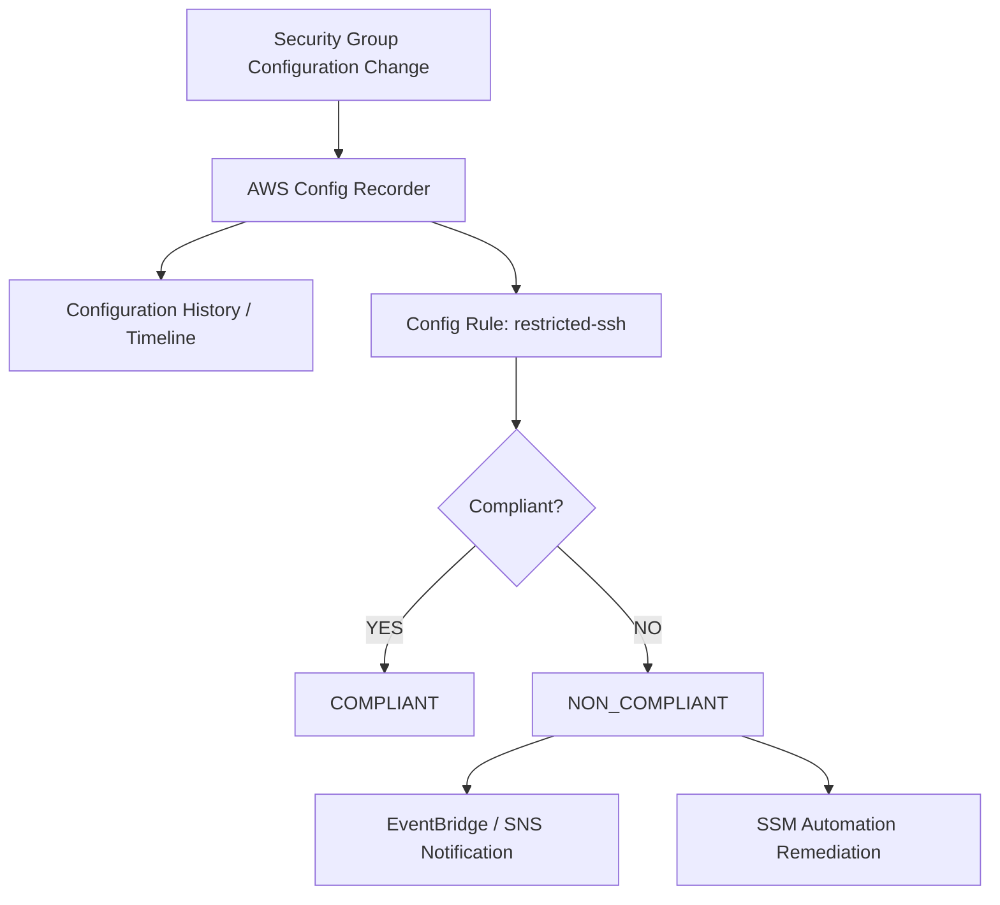

# 🛡️ 22-08. AWS Config: Configuration History, Rules & Remediation

> AWS SAA-C03 · 검색 키워드: **AWS Config, Configuration Item, Recorder, Compliance, COMPLIANT, NON_COMPLIANT, restricted-ssh, approved-amis-by-id, Resource Timeline, SSM Automation, Remediation, Aggregator, Athena**

## 🇰🇷 1. AWS Config란?

**AWS Config**는 AWS 리소스의 설정 상태와 설정 변경 이력을 기록하고, 규정 준수(Compliance) 규칙에 따라 리소스를 평가하는 서비스다.

- **CloudWatch:** CPU가 높나? 오류율은?
- **CloudTrail:** 누가 `AuthorizeSecurityGroupIngress` API를 실행했나?
- **AWS Config:** Security Group에 SSH 22번 포트가 전체 공개돼 있나? 언제 바뀌었나?



## 🇰🇷 2. AWS Config 시작 설정

| 요소 | 역할 |
|---|---|
| **Configuration Recorder** | 지원되는 리소스의 구성 변경을 기록 |
| Recording Scope | 모든 지원 리소스 또는 특정 리소스 유형 기록 선택 |
| Service-linked Role | AWS Config가 리소스 정보를 수집할 AWS IAM 권한 |
| S3 Delivery Channel | 구성 스냅샷과 이력 데이터를 S3로 전달 |
| SNS Topic (선택) | 구성 변경·상태 알림 전달 |
| Config Rules | 규정 준수 평가 기준. Recorder와 별도로 생성 |

- AWS Config는 **리전 기반 서비스**이므로 필요한 리전마다 설정한다.
- 계정·리전 간 결과 통합은 **Config Aggregator**.
- AWS 서비스 자체에 허용된 리소스 범위·전역 리소스 홈 리전 제한에 주의한다. 글로벌 IAM User/Group/Role/Policy는 일부 리전에서만 기록 가능하다.
- **비용:** 기록된 Configuration Item·Rule 평가 등에 따라 과금. 리소스를 많이 기록하면 비용이 증가한다. 강의의 과거 고정 가격을 암기하지 말고 현재 리전별 요금표를 확인한다.

## 🇰🇷 3. AWS Config Rules

| 종류 | 설명 | 예시 |
|---|---|---|
| **AWS Managed Rule** | AWS에서 제공하는 관리형 검사 | `restricted-ssh`, `approved-amis-by-id` |
| **Custom Rule** | 직접 구현한 규정 검사 | 지정 EC2 Instance Type 검사, 조직 내부 정책 |

규칙 트리거는 리소스 **구성 변경 시(Configuration Change)** 또는 **주기적으로(Periodic)** 설정할 수 있다(규칙에 따라 지원 방식 상이).

**Config의 상태**

- `COMPLIANT`: 정의된 규칙 준수.
- `NON_COMPLIANT`: 규칙 위반.
- 평가 대상 밖이거나 평가 불가인 경우에는 다른 결과가 나타날 수 있다.

> **중요:** AWS Config는 기본적으로 규정 준수 여부를 **탐지/평가**하는 서비스다. 규칙이 있다고 해서 Security Group 수정 자체를 **차단**하는 것은 아니다. IAM/SCP 등의 접근 통제와 구별한다.

## 🇰🇷 4. 실습 핵심: restricted-ssh

### 문제 상황

EC2 Security Group에 다음 인바운드 규칙이 있다.

```text
Type: SSH
Protocol: TCP
Port: 22
Source: 0.0.0.0/0 (인터넷 전체)
```

`restricted-ssh`는 SSH 접근 허용 주소가 너무 광범위한지 평가한다.

| 인바운드 정책 | 평가 |
|---|---|
| TCP 22, `0.0.0.0/0` 또는 `::/0` | **NON_COMPLIANT** |
| TCP 22, 특정 관리 IP `203.0.113.10/32` | **COMPLIANT** |
| 22번 포트 인바운드 규칙 없음 | **COMPLIANT** |

- “모든 SSH를 금지”라는 뜻이 아니라 **인터넷 전체 공개를 금지**한다는 뜻.
- 연결된 Config Rule 식별자는 `INCOMING_SSH_DISABLED`.
- **실습:** 보안 그룹에서 전체 공개 22번 인바운드 규칙을 삭제 → Config가 변경 감지 → 재평가 후 COMPLIANT.

### Resource Timeline과 CloudTrail

```text
Before: SG Port22 Open → Config NON_COMPLIANT
  ↓ RevokeSecurityGroupIngress API
CloudTrail: 누가 언제 변경했는지 기록
  ↓ AWS Config 기록 갱신
After:  SG Port22 Removed → Config COMPLIANT
```

- **Config Resource Timeline:** 리소스 설정이 시간에 따라 어떻게 달라졌는지.
- **CloudTrail:** 변경을 일으킨 사용자/역할과 API 호출. 두 서비스를 결합해 조사하면 효과적이다.

## 🇰🇷 5. Config Remediation: SSM Automation

Config Rule 자체는 리소스가 잘못된 설정으로 변경되는 것을 직접 막지 않는다. 하지만 **규정 위반을 찾은 뒤** SSM Automation Runbook(자동화 문서)으로 수정할 수 있다.

```text
Config Rule: NON_COMPLIANT
           ↓
Manual or Automatic Remediation
           ↓
SSM Automation Runbook
           ↓
Security Group inbound rule 수정
           ↓
Config Rule 재평가
```

- **Manual:** 운영자가 직접 실행 요청.
- **Automatic:** 위반 발견 시 설정된 Automation으로 자동 실행.
- SSM Runbook은 AWS 관리형 또는 사용자 지정으로 만들 수 있다.
- 필요한 리소스 ID를 Parameter로 전달할 수 있고, 실패 시 재시도 횟수·간격을 설정한다.
- **아무 Runbook이나 선택하면 안 된다.** 예를 들어 `AttachEBSVolume`은 EBS 볼륨 연결 작업이므로 `restricted-ssh` 문제를 해결할 수 없다.
- 일부 Automation이 Lambda를 호출해 복잡한 사용자 지정 수정 로직을 수행하게 할 수도 있다.

## 🇰🇷 6. 알림 및 계정·리전 통합

- Config 규정 준수 변경 이벤트 → **EventBridge** → SNS/Lambda 등.
- Config에서 구성 항목 전달 및 알림용 **SNS** 사용 가능.
- 여러 계정/리전 결과를 하나의 화면에 모으려면 **AWS Config Aggregator**.
- S3에 전달된 이력·스냅샷은 장기 분석에 활용 가능하며 **Athena**로 SQL 분석할 수 있다.

## 🎯 Exam Triggers

| 문제 키워드 | 선택 |
|---|---|
| 특정 포트(예: TCP 84)가 SG에서 인터넷 전체 공개됐나? | Config Rule (적절한 관리형·Custom Rule) |
| SSH 22번 전체 공개 금지 | `restricted-ssh` |
| 특정 AMI만 EC2에서 사용해야 함 | `approved-amis-by-id` |
| 리소스의 과거 설정 비교 | Config Resource Timeline |
| 위반 자동 수정 | Config + SSM Automation |
| 변경 행위 자체를 예방·차단 | Config 단독으로는 불가; IAM/SCP 등 통제 필요 |
| 조직 전체 준수 현황 모으기 | Config Aggregator |

## 📝 Review Questions

> 해당 문서의 개념을 확인하는 SAA 스타일 복습 문제. 정답은 질문 아래 **정답 및 해설**에서 확인한다.

### Q30. EC2 보안 그룹 SSH 22번 포트가 전체 인터넷에 공개됐는지 평가하고 싶다. 알맞은 AWS Config 관리형 규칙은?

- A. approved-amis-by-id
- B. CloudTrail Insights
- C. restricted-ssh
- D. EventBridge Sandbox

### Q31. AWS Config가 NON_COMPLIANT를 감지할 때 자동으로 올바른 설정을 적용하려면?

- A. CloudTrail Event History만 사용
- B. AWS Config + SSM Automation Remediation
- C. Detailed Monitoring만 활성화
- D. S3 Export Task

### Q32. 여러 AWS 계정·리전에서 AWS Config 규정 준수 결과를 모아 확인하려면?

- A. Metric Stream
- B. Log Stream
- C. Schema Registry
- D. AWS Config Aggregator

### ✅ 정답 및 해설

| 문제 | 정답 | 풀이 핵심 |
|---|---|---|
| Q30 | **C** | restricted-ssh는 SSH 22를 0.0.0.0/0 또는 ::/0에 개방했는지 평가한다. 특정 관리 IP 허용은 규정 준수 가능. |
| Q31 | **B** | Config 자체는 변경을 막지 않지만 SSM Automation Runbook을 연결하면 사후 교정 조치를 수행할 수 있다. |
| Q32 | **D** | Config Aggregator는 계정과 리전을 아우르는 설정·준수 결과 조회를 지원한다. |

## 📚 Vocabulary — English · 한국어 · 日本語

> GitHub 검색 시 영어 표제어 그대로 검색하면 관련 설명으로 이동하기 쉽다.

| English | 한국어 | 日本語 |
|---|---|---|
| Compliance | 규정 준수 | コンプライアンス |
| Configuration Item | 구성 항목 | 構成アイテム |
| Configuration Recorder | 구성 기록기 | 構成レコーダー |
| Configuration History | 구성 변경 이력 | 構成履歴 |
| Resource Timeline | 리소스 시간별 변경 이력 | リソースタイムライン |
| Managed Rule | 관리형 규칙 | マネージドルール |
| Custom Rule | 사용자 지정 규칙 | カスタムルール |
| Compliant | 규정 준수 | 準拠 |
| Non-compliant | 규정 미준수 | 非準拠 |
| Remediation | 교정 조치 | 修復 |
| SSM Automation | 시스템즈 매니저 자동화 | Systems Manager オートメーション |
| Runbook | 자동화 절차 문서 | ランブック |
| Aggregator | 집계기 | アグリゲーター |


## 🇯🇵 日本語 Summary

AWS Config はリソース設定の履歴を記録し、Config Rules を使ってコンプライアンスを評価する。`restricted-ssh` ルールは Security Group の SSH 22 番ポートがインターネット全体に公開されていないか確認する。Config は設定変更そのものをブロックしないが、NON_COMPLIANT なリソースを SSM Automation で修復できる。Resource Timeline は設定の変化、CloudTrail は変更した API 呼び出し元を調べる。複数アカウント・リージョンの集計には Aggregator を使用する。

**試験の注意点:** Config Rule は設定違反を検知するが、変更そのものをブロックしない。修復には SSM Automation、API 操作の特定には CloudTrail を使う。

## 🇺🇸 English Summary

AWS Config records resource configurations and evaluates compliance with managed or custom rules. `restricted-ssh` flags security groups that allow unrestricted SSH ingress. Config is detective, not preventive: use SSM Automation for manual or automatic remediation. A resource timeline shows configuration changes, whereas CloudTrail identifies the API activity responsible. Aggregators provide cross-account and cross-Region compliance visibility.

**Exam tip:** Config evaluates settings and history. It does not block an action; remediation happens afterward through Automation. CloudTrail identifies the API caller.

## 📚 References

- [AWS Config resource recording](https://docs.aws.amazon.com/config/latest/developerguide/select-resources.html)
- [AWS Config restricted-ssh](https://docs.aws.amazon.com/config/latest/developerguide/restricted-ssh.html)
- [AWS Config Rules](https://docs.aws.amazon.com/config/latest/developerguide/evaluate-config.html)
