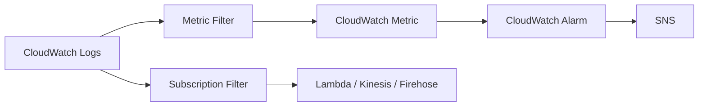

# 🧠 22-09. Final Comparison & Architecture Patterns

> AWS SAA-C03 · **이번 섹션의 마지막 종합 비교 자료**  
> 검색 키워드: **CloudWatch vs CloudTrail vs Config, EventBridge vs Alarm vs S3 Event, Metric Filter vs Subscription Filter, Logs Insights vs Live Tail, Agent vs Detailed Monitoring, Decision Tree, ALB, Security Group, S3, EC2**

## 🇰🇷 1. 가장 중요한 세 서비스 비교

| 비교 관점 | CloudWatch | CloudTrail | AWS Config |
|---|---|---|---|
| 핵심 질문 | **지금 상태·성능이 어떤가?** | **누가 어떤 API를 호출했나?** | **설정이 어떻게 바뀌고 준수하는가?** |
| 다루는 데이터 | Metrics·Logs·Alarms | AWS 계정 API·활동 감사 이벤트 | Resource Configuration Items·Rule 준수 결과 |
| EC2 사례 | CPU 95% / ERROR 로그 | `TerminateInstances` 호출자 | SG SSH 인터넷 공개 여부 |
| ALB 사례 | RequestCount / HTTP 5XX | 누가 Listener를 수정했나 | HTTPS Listener/인증서 설정 준수 |
| S3 사례 | 버킷 요청 관련 지표 | `GetObject` API (Data Events 별도 활성화) | 버킷 Public Access 설정 변경 |
| 자동 알림 | Alarm → SNS / Lambda | EventBridge Rule 등과 연동 | Compliance Change → EventBridge / SNS |
| 보관 핵심 | Metrics/Logs 보존 정책 | Event History 90일 관리 이벤트, Trail→S3 | Configuration History / S3 |

**암기:** `CloudWatch = 성능`, `CloudTrail = API 활동`, `AWS Config = 설정·규정 준수`.

## 🇰🇷 2. CloudWatch Alarm vs EventBridge vs S3 Event Notifications

| 무엇이 트리거인가? | 선택 | 이유 |
|---|---|---|
| CPU > 80%인 상태가 일정 기간 지속 | **CloudWatch Alarm** | 지표 Threshold / M out of N |
| EC2 상태가 stopped로 변경 | **EventBridge** | AWS 서비스가 보내는 상태 변경 이벤트 |
| AWS API `DeleteTable`이 호출됨 | **CloudTrail Trail + EventBridge** | API 활동 감사 이벤트 기반 규칙 |
| S3 객체 업로드 후 Lambda 실행 | **S3 Event Notification 또는 EventBridge** | S3가 직접 알리거나 EventBridge를 통해 전달 가능 |
| 매일 09:00 작업 실행 | **EventBridge Scheduler** | Cron / Rate 기반 예약 |
| 보안 그룹 SSH 전체 공개 검사 | **AWS Config Rule** | 리소스의 설정 준수 검사 |

**오해 방지:** Lambda와 SNS를 직접 호출할 수 있는 서비스가 여러 개다. **목표(Target)가 같아도 트리거가 다른 것**이다.

## 🇰🇷 3. CloudWatch Logs 기능 비교

| 목표 | 기능 | 관련 서비스 |
|---|---|---|
| 로그 저장 / 보존 | CloudWatch Logs | Log Group / Stream |
| 저장된 로그에서 ERROR 찾기 | Logs Insights | 쿼리 언어 / 시간 범위 |
| 새 로그 한 건마다 값 1로 계산 | Metric Filter | CloudWatch Metrics / Alarm |
| 새 로그를 Lambda 등으로 지속 전달 | Subscription Filter | Kinesis / Firehose / Lambda |
| 로그가 들어오는 모습을 바로 보기 | Live Tail | 콘솔 디버깅 |
| 지난달 로그를 S3에 모아서 내보내기 | S3 Export Task | `CreateExportTask` |
| 여러 계정의 로그를 하나로 모으기 | Cross-Account Log Subscription | Subscription Destination / Access Policy / IAM Role |

### Log → Metric → Alarm vs Log → Stream

## 🇰🇷 4. EC2 Monitoring 비교

| 목적 | 서비스 |
|---|---|
| CPU 사용률 기본 5분 주기 | EC2 Basic Monitoring |
| CPU 사용률 1분 주기 | EC2 Detailed Monitoring |
| EC2 메모리 사용률(RAM) | Unified CloudWatch Agent |
| EC2 애플리케이션 로그 | Unified CloudWatch Agent + Logs |
| EC2 시스템 상태 검사 실패 | StatusCheckFailed_System / Alarm / Recovery |
| EC2 누가 종료했나 | CloudTrail |

## 🇰🇷 5. 사례별 실전 아키텍처

### A. ALB에서 HTTPS가 사라졌다

| 물음 | 서비스 |
|---|---|
| ALB 5XX 오류가 증가했는가? | CloudWatch Metrics / Alarm |
| 누가 리스너를 삭제하는 API를 호출했나? | CloudTrail |
| HTTPS 리스너가 있어야 한다는 정책을 어겼는가? | AWS Config Rule |
| 규정 위반 시 관리자에게 이메일 | AWS Config → EventBridge → SNS |

### B. CPU가 높을 때 자동 확장

`CloudWatch CPUUtilization → Alarm → Auto Scaling Policy → EC2 Scale Out`

**CPU 높음 → 곧바로 Terminate**는 일반적인 운영 정답이 아니다. 부하 증가면 Scale Out과 원인 분석을 고려한다.

### C. S3 객체를 업로드하자 데이터 처리

`S3 Object Created → S3 Event Notification / EventBridge Rule → Lambda → processing`

`S3 CreateBucket API를 누가 호출했는가`는 CloudTrail의 **Management Event**, `S3 GetObject 호출 감사`는 별도 로깅 설정이 필요한 **Data Event**이다.

### D. 과거 이벤트로 6개월마다 재시험

`EventBridge Event Bus → Archive (6개월 이상 보관) → Replay → Rule → Lambda`

Lambda가 주문을 중복 처리하지 않도록 멱등성을 구현한다.

### E. 보안 그룹 TCP 84 포트 공개 여부

`Config Custom Rule → Security Group Configuration → NON_COMPLIANT → SSM Automation / EventBridge`

CloudWatch는 지표·로그, CloudTrail은 API 호출자, AWS Config는 설정을 검사한다.

## 🇰🇷 6. 한 줄 의사 결정 가이드

1. **“CPU / latency / error rate / count”** → CloudWatch Metrics / Alarm.
2. **“logs / grep ERROR / count messages”** → CloudWatch Logs + Logs Insights / Metric Filter.
3. **“Who called this API?”** → CloudTrail.
4. **“Was this resource configuration compliant? How did it change?”** → AWS Config.
5. **“When an event happens, run something”** → EventBridge / 해당 AWS 서비스의 직접 알림 기능.
6. **“Run something every hour”** → EventBridge Scheduler.
7. **“Find top 10 IPs”** → CloudWatch Contributor Insights.
8. **“Reprocess old events”** → EventBridge Archive & Replay.
9. **“Automatically fix NON_COMPLIANT”** → Config + SSM Automation.

## 🇰🇷 7. 자주 틀리는 함정 12선

1. **Detailed Monitoring ≠ RAM 수집**. Agent 필요.
2. **Metric Filter ≠ Subscription Filter**. 숫자 생성 vs 로그 전달.
3. **Logs Insights ≠ Live Tail**. 저장 로그 쿼리 vs 실시간에 가까운 신규 로그 표시.
4. **S3 Export ≠ Near-real-time**. 배치 내보내기.
5. **CloudWatch Metric Streams ≠ CloudWatch Logs Subscriptions**. 지표 vs 로그.
6. **EventBridge Rule ≠ Scheduler**. 이벤트 기반 vs 시간 기반.
7. **CloudTrail ≠ AWS Config**. API 호출자 vs 리소스 설정·규정 준수.
8. **CloudTrail Event History 90일 = Management Events**. 모든 이벤트 유형이 자동 90일 보관되는 것은 아님.
9. **S3 GetObject ≠ Management Event**. 객체 접근은 Data Event.
10. **Config Rule은 변경을 차단하지 못함**. 수정은 SSM Automation 등 추가 구성.
11. **EventBridge API Call via CloudTrail**: 활성 로깅 Trail 필요, Best Effort 전달.
12. **Composite Alarm은 여러 Metric을 직접 읽는 것이 아니라 다른 Alarm의 상태를 조합**.

## 📝 Review Questions

> 해당 문서의 개념을 확인하는 SAA 스타일 복습 문제. 정답은 질문 아래 **정답 및 해설**에서 확인한다.

### Q33. ALB의 5XX 오류가 증가했는지 시각화하고, 누가 HTTPS 리스너를 삭제했으며, 보안 규칙 위반이 있는지도 조사하려 한다. 서비스 조합은?

- A. CloudWatch / CloudTrail / AWS Config
- B. CloudTrail / CloudWatch / EventBridge
- C. AWS Config 단독
- D. EventBridge Scheduler 단독

### Q34. EC2 CPU가 높아 자동 확장을 실행하려 한다. EC2가 stopped로 바뀔 때 SNS 알림을 보내는 요구사항은 별도로 있다. 각각 무엇을 사용할까?

- A. CloudTrail / Athena
- B. Config / CloudWatch Agent
- C. CloudWatch Alarm + Auto Scaling / EventBridge Rule + SNS
- D. EventBridge Archive / S3 Export

### Q35. 새 ERROR 로그의 횟수를 집계해 경보를 만들고, 동시에 새 ERROR 로그 원문은 Lambda로 보내려 한다. 필요한 두 필터는?

- A. Metric Filter + Subscription Filter
- B. Event Pattern + S3 Lifecycle
- C. Config Rule + Metric Streams
- D. Logs Insights + Schema Registry

### Q36. Security Group의 TCP 84번 전체 공개 여부를 감시하며, 누가 설정을 바꾸었는지 조사하려고 한다. 알맞은 조합은?

- A. CloudWatch + CloudTrail Insights
- B. EventBridge Scheduler + SNS
- C. Logs Insights + Live Tail
- D. AWS Config Rule + CloudTrail

### ✅ 정답 및 해설

| 문제 | 정답 | 풀이 핵심 |
|---|---|---|
| Q33 | **A** | CloudWatch는 성능, CloudTrail은 API 실행자, AWS Config는 설정 변경과 준수 여부를 담당한다. |
| Q34 | **C** | 숫자 지표의 임계값은 Alarm, 리소스 상태 변경 이벤트는 EventBridge Rule이 알맞다. |
| Q35 | **A** | Metric Filter는 숫자 지표, Subscription Filter는 로그 원문을 전달한다. |
| Q36 | **D** | Config는 공개 설정을 검사하고, CloudTrail은 변경 API 호출자를 추적한다. |

## 📚 Vocabulary — English · 한국어 · 日本語

> GitHub 검색 시 영어 표제어 그대로 검색하면 관련 설명으로 이동하기 쉽다.

| English | 한국어 | 日本語 |
|---|---|---|
| Metric vs Log | 숫자 시계열 지표 vs 상세 이벤트 기록 | メトリクスとログ |
| Audit vs Monitoring | API 호출 감사 vs 시스템 성능 관찰 | 監査と監視 |
| Detective vs Preventive | 위반 사후 탐지 vs 행위 사전 차단 | 発見的統制と予防的統制 |
| Metric Filter vs Subscription Filter | 로그를 숫자로 변환 vs 로그 자체 전달 | メトリクス変換とログ転送 |
| Live Tail vs Logs Insights | 새 로그 실시간 관찰 vs 저장 로그 쿼리 | ライブ監視と過去ログ分析 |
| Replay vs Retry | 과거 이벤트 재전송 vs 실패 재시도 | リプレイとリトライ |
| Stop vs Terminate | EC2 중지 후 재시작 가능 vs EC2 종료 | 停止と終了 |
| Scale Out vs Scale Up | 인스턴스 수 증가 vs 단일 인스턴스 성능 향상 | スケールアウトとスケールアップ |

## 🇯🇵 日本語 Summary

CloudWatch は性能・ログ、CloudTrail は API 操作の監査、AWS Config はリソース設定の履歴とコンプライアンスを担当する。EventBridge はイベントを条件に従ってルーティングする。CloudWatch Metric Filter はログから指標を生成し、Subscription Filter はログそのものを送信する。監視したい対象・判断条件・期待するアクションを区別してサービスを選ぶ。

**使い分け:** 数字の異常は CloudWatch、API を実行した主体は CloudTrail、設定の準拠は AWS Config、イベントを起点とする処理は EventBridge。

## 🇺🇸 English Summary

CloudWatch monitors operational metrics and logs; CloudTrail audits account and API activity; AWS Config tracks configuration history and compliance. EventBridge routes events to targets. Metric filters turn logs into metrics, while subscription filters forward log events. Choose the right service by identifying the trigger, the underlying data, and the expected action.

**Decision rule:** Identify the source (metric, log, API call, configuration, or event), then the trigger, then the required action. Similar-looking alerts can be built through different services.
