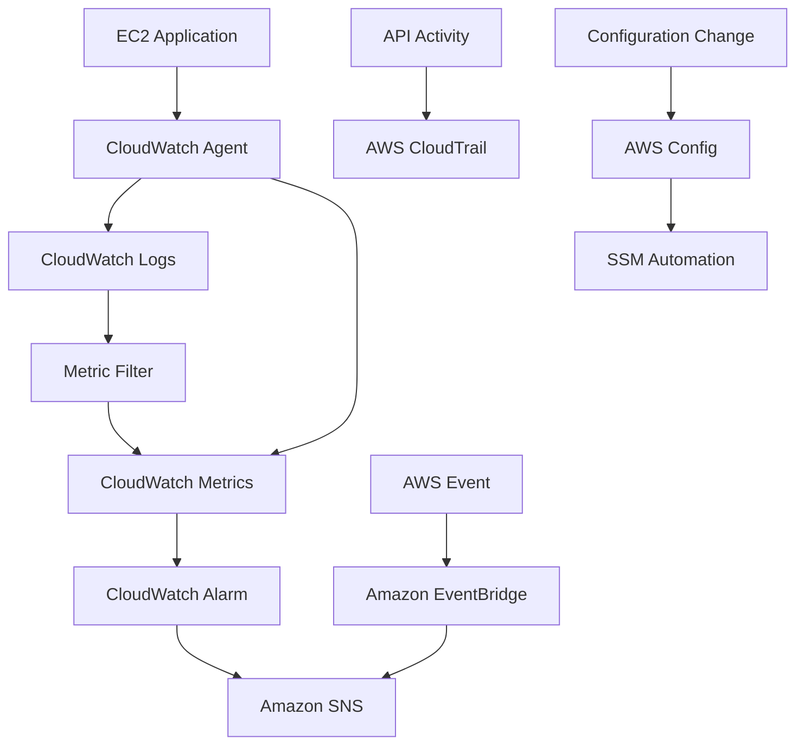

# 📡 22. Monitoring, Audit & Performance

> AWS Certified Solutions Architect – Associate (SAA-C03)  
> **Udemy Section 24 | GitHub Section 22**  
> 학습 기준: 2026-10-13

## 📌 Overview

이번 섹션에서는 AWS의 성능 모니터링, 로그 분석, 경보, 이벤트 라우팅, API 감사, 리소스 구성 및 규정 준수를 학습한다.

주요 서비스:

- Amazon CloudWatch
- Amazon EventBridge
- AWS CloudTrail
- AWS Config

SAA 시험에서는 서비스의 역할을 정확히 구분하고, 요구사항에 맞는 모니터링 및 자동화 아키텍처를 선택하는 것이 중요하다.

## 🎯 Learning Objectives

1. CloudWatch Metrics와 Logs의 구조를 이해한다.
2. CloudWatch Agent와 EC2 Detailed Monitoring을 구분한다.
3. Logs Insights, Metric Filter, Subscription Filter, Live Tail의 차이를 설명한다.
4. CloudWatch Alarms와 Composite Alarms를 설계한다.
5. EventBridge의 이벤트 기반 아키텍처를 이해한다.
6. CloudTrail의 API 감사 및 이벤트 유형을 구분한다.
7. AWS Config로 구성 변경과 규정 준수를 평가한다.
8. 서비스별 사용 사례를 비교하고 SAA 문제에 적용한다.

## 📂 Contents

| File | Description |
|---|---|
| [22-01-CloudWatch-Metrics-and-Agent.md](./22-01-CloudWatch-Metrics-and-Agent.md) | Metrics, Namespace, Dimension, Agent, Detailed Monitoring |
| [22-02-CloudWatch-Logs-Fundamentals.md](./22-02-CloudWatch-Logs-Fundamentals.md) | Log Group, Stream, Event, 로그 수집 |
| [22-03-CloudWatch-Logs-Analysis-and-Delivery.md](./22-03-CloudWatch-Logs-Analysis-and-Delivery.md) | Logs Insights, Filters, Live Tail, S3 Export |
| [22-04-CloudWatch-Alarms.md](./22-04-CloudWatch-Alarms.md) | Alarms, Composite Alarms, EC2 Recovery |
| [22-05-Amazon-EventBridge.md](./22-05-Amazon-EventBridge.md) | Event Bus, Rule, Target, Scheduler, Archive & Replay |
| [22-06-CloudWatch-Specialized-Insights.md](./22-06-CloudWatch-Specialized-Insights.md) | Container, Lambda, Contributor, Application Insights |
| [22-07-AWS-CloudTrail.md](./22-07-AWS-CloudTrail.md) | API Audit, Event History, Trail, Data Events |
| [22-08-AWS-Config.md](./22-08-AWS-Config.md) | Config Rules, Compliance, Remediation, Aggregator |
| [22-09-Comparison-and-Architecture-Patterns.md](./22-09-Comparison-and-Architecture-Patterns.md) | 종합 비교, 서비스 선택, 아키텍처, 시험 함정 |

### 📖 Documentation Structure

각 상세 문서는 동일한 학습 구조를 따른다.

1. 🇰🇷 Korean Detailed Explanation
2. 🎯 SAA Exam Triggers
3. 📝 Review Questions & Answers
4. 📚 Vocabulary (English / 한국어 / 日本語)
5. 🇯🇵 日本語 Summary
6. 🇺🇸 English Summary

복습 문제 총 36개와 핵심 용어는 각 주제 문서에 통합되어 있다.

## 🧭 SAA Service Selection Guide

| Requirement | Service |
|---|---|
| CPU 및 성능 지표 모니터링 | CloudWatch Metrics |
| EC2 RAM 사용률 수집 | CloudWatch Agent |
| 저장된 로그 검색·분석 | CloudWatch Logs Insights |
| 로그에서 숫자 지표 생성 | Metric Filter |
| 새 로그를 다른 서비스로 전달 | Subscription Filter |
| 신규 로그 실시간 관찰 | Live Tail |
| 지표 임계값 경보 | CloudWatch Alarm |
| 여러 경보 조건 결합 | Composite Alarm |
| AWS 이벤트 기반 자동화 | EventBridge |
| 예약된 작업 실행 | EventBridge Scheduler |
| 과거 이벤트 저장 및 재생 | EventBridge Archive & Replay |
| AWS API 호출 감사 | CloudTrail |
| S3 객체 접근 감사 | CloudTrail Data Events |
| 리소스 구성 변경 추적 | AWS Config |
| 규정 위반 자동 수정 | Config + SSM Automation |

## 🏗️ Architecture Example

## ⚠️ Exam Traps

- Detailed Monitoring은 RAM 사용률을 추가하지 않는다.
- Metric Filter는 로그를 숫자로 변환한다.
- Subscription Filter는 로그 자체를 전달한다.
- Logs Insights는 저장된 로그를 검색·분석한다.
- Live Tail은 새 로그를 거의 실시간으로 표시한다.
- EventBridge Scheduler는 예약 작업에 사용한다.
- CloudTrail Event History는 최근 90일의 관리 이벤트를 조회한다.
- CloudTrail Data Events는 별도로 로깅을 설정해야 한다.
- AWS Config는 설정 위반을 탐지하지만 변경 자체를 차단하지 않는다.
- Composite Alarm은 여러 Alarm의 상태를 조합한다.

## 🎯 Final Review

**CloudWatch = Performance & Logs**

**CloudTrail = API Activity & Audit**

**AWS Config = Configuration & Compliance**

**EventBridge = Event-Driven Automation**

문제 풀이 중 모르는 키워드가 등장하면
[22-09 종합 비교](./22-09-Comparison-and-Architecture-Patterns.md)에서 먼저 서비스를 구분한 뒤, 해당 개념별 문서에서 설명·복습 문제·Vocabulary·일본어 및 영어 요약을 함께 확인한다.

---

## 🇯🇵 日本語 Summary

CloudWatch はメトリクスとログを監視する。CloudTrail は API 操作の履歴を記録する。AWS Config はリソースの構成変更とコンプライアンスを評価する。EventBridge はイベントを条件に従ってターゲットへ配信する。

SAA 試験では、監視対象が性能指標、API 操作、構成変更、イベントのどれに該当するかを判断することが重要である。

## 🇺🇸 English Summary

Amazon CloudWatch monitors operational metrics and logs. AWS CloudTrail audits API activity. AWS Config tracks resource configuration changes and evaluates compliance. Amazon EventBridge routes events to AWS targets.

For the SAA exam, identify the observed data, the triggering condition, and the required action before choosing a service.
