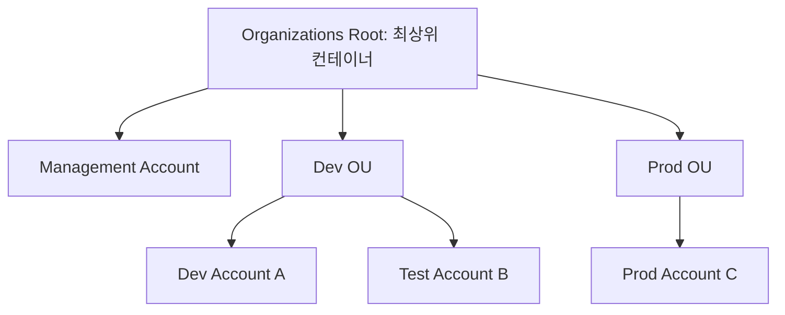

# 📘 23-01. AWS Organizations & Multi-Account Structure

> [!NOTE]
> **AWS SAA-C03 Study Note**  
> 핵심 키워드: `AWS Organizations` · `Management Account` · `Member Account` · `OU` · `Consolidated Billing` · `Root`

## 🇰🇷 1. AWS 계정과 Organizations의 관계

**AWS 계정(Account)**은 독립된 리소스와 과금·보안 경계를 가진 기본 단위이다. 계정마다 별도의 Root User, IAM 사용자/역할, EC2, VPC, S3 등을 가질 수 있다. **AWS Organizations**는 이런 계정을 조직으로 묶고 중앙 관리하는 글로벌 서비스다.

- **Management Account(관리 계정):** 조직을 생성한 AWS 계정. 조직·계정·OU·정책을 관리한다.
- **Member Account(멤버 계정):** 조직에 소속된 일반 AWS 계정. 자기 계정의 리소스와 Root User를 계속 가진다.
- **Organizations Root:** OU와 계정을 담는 최상위 **컨테이너**. **AWS 계정의 Root User와 전혀 다른 개념**이다.
- 일반적으로 Management Account에는 애플리케이션 워크로드를 넣지 않고 조직 관리 용도로 사용한다.



## 🇰🇷 2. 조직 생성 및 계정 추가

관리 계정에서 Organizations를 생성하면 조직 Root가 만들어지고, 생성한 계정이 Management Account가 된다. 이후 두 방식으로 계정을 추가한다.

1. **Create an AWS account:** 조직에서 새 멤버 계정을 자동 생성한다. 조직 관리용 IAM Role 등이 구성될 수 있다.
2. **Invite an existing AWS account:** 기존 AWS 계정에 초대장을 보내고 상대 계정이 수락하면 합류한다. **초대 유효기간은 15일**이다.

**주의:** 이미 존재하던 계정을 초대했다고 해서 관리 계정의 사람이 그 멤버 계정의 모든 리소스를 자동으로 조작할 수 있는 것은 아니다. 리소스 조작에는 별도 IAM Role, Trust Policy 등이 필요하다.

## 🇰🇷 3. Organizational Unit(OU)

**OU는 AWS 사용자 그룹이 아니라 AWS 계정을 묶는 조직 단위**이다. OU는 하위 OU를 포함하는 계층 구조를 형성하고, 각 멤버 계정은 한 시점에 하나의 직접 부모(Root 또는 OU)를 갖는다.

```text
Root
├── Management Account
├── Dev OU
│   ├── Dev Account
│   └── Test Account
└── Prod OU
    ├── HR OU → HR Account
    └── Finance OU → Finance Account
```

`Finance Account`는 `Root → Prod OU → Finance OU → Account` 경로상의 정책을 상속한다. 계정에 적용할 거버넌스 정책을 OU 단위로 관리하면 계정이 많아져도 편리하다.

## 🇰🇷 4. Organizations의 기타 기능

- **Consolidated Billing:** 여러 AWS 계정의 사용량과 청구서를 통합 관리한다. 서비스별 집계 사용량에 따른 볼륨 할인 혜택을 받을 수 있다.
- **Reserved Instances / Savings Plans Sharing:** 자격 요건을 만족하는 할인 혜택을 조직 내 공유하도록 관리할 수 있다. 공유 설정 및 적용 규칙을 확인해야 한다.
- **Organizations Policies:** SCP 외에도 Tag Policy, Backup Policy 등의 조직 정책을 활용할 수 있다.
- **중앙 감사/로깅:** CloudTrail 등과 결합해 다중 계정 활동 감사를 일관되게 구성한다.

## 🇰🇷 5. 다른 IAM 구성요소와 비교

| 구성요소 | 누구를 관리하는가? | 핵심 기능 |
|---|---|---|
| AWS Organizations | AWS **계정** | 조직, OU, 통합 결제, 조직 정책 |
| SCP | 멤버 계정 내 Principal의 **최대 허용 범위** | 조직 차원의 제한. 권한을 직접 부여하지 않음 |
| IAM | 계정 안의 사용자/역할 | 실제 AWS API 권한 부여 |
| IAM Identity Center | 직원·그룹의 AWS 계정 접근 | 여러 계정 SSO와 Permission Set |

## 🎯 Exam Notes

> [!IMPORTANT]
> SAA-C03에서 구분해야 할 핵심 포인트입니다.

- Organizations는 여러 **독립 AWS 계정**을 묶는다. 계정을 하나로 합치지 않는다.
- Organizations Root는 **OU 컨테이너**이며 계정 Root User가 아니다.
- Management Account는 조직 생성 계정. SCP 적용 예외지만 그 계정의 IAM 사용자까지 자동 관리자가 되는 것은 아니다.
- OU 정책은 하위 OU와 계정에 상속된다. OU는 사용자를 묶는 IAM Group과 다르다.
- 통합 결제와 사용량 할인, RI/Savings Plans Sharing 설정은 Organizations의 대표 이점이다.

## 📝 Review Questions

> [!TIP]
> 먼저 답을 생각한 뒤 **정답 및 해설**을 펼쳐 확인하세요.

### Q1. 개발·운영 워크로드를 분리하면서 청구서를 통합하고자 한다. 핵심 서비스와 구조는?

<details>
<summary>정답 및 해설 보기</summary>

**AWS Organizations + 별도 Member Account와 OU.** 워크로드별 계정 격리를 유지하면서 Consolidated Billing을 사용한다.

</details>

### Q2. AWS Organizations의 Root와 개별 AWS 계정의 Root User는 같은 개념인가?

<details>
<summary>정답 및 해설 보기</summary>

**아니다.** Organizations Root는 계정·OU를 담는 최상위 컨테이너이고 Root User는 해당 계정의 최상위 로그인 주체다.

</details>

### Q3. 기존 AWS 계정을 조직에 초대했으나 초대를 16일 동안 수락하지 않았다. 어떻게 될까?

<details>
<summary>정답 및 해설 보기</summary>

**초대 만료.** 조직 가입 초대 유효기간은 15일이며 다시 초대해야 한다.

</details>

### Q4. Finance OU 안에 계정을 배치한 뒤 Prod OU에 SCP를 붙였다. Finance 계정에도 적용되는가?

<details>
<summary>정답 및 해설 보기</summary>

**적용된다.** 상위 OU의 SCP는 하위 OU와 계정에 상속된다.

</details>

### Q5. Management Account가 초대한 멤버 계정의 EC2를 즉시 자유롭게 종료할 수 있는가?

<details>
<summary>정답 및 해설 보기</summary>

**아니다.** 조직 관리 권한과 다른 계정의 리소스 작업 권한은 별개이며 적절한 Cross-Account IAM Role 등의 접근 권한이 필요하다.

</details>

## 🇯🇵 日本語 Summary

AWS Organizations は複数の独立した AWS アカウントを一元管理するグローバルサービス。組織を作成したアカウントが Management Account となり、Member Account を OU で階層的に整理できる。Organizations Root はアカウントの Root User とは異なる。Consolidated Billing、組織ポリシー、RI/Savings Plans の共有管理も重要。

**試験の判断:** アカウントの分離と一元管理は Organizations、社員の SSO は IAM Identity Center。

## 🇺🇸 English Summary

AWS Organizations centrally manages independent AWS accounts through a management account, member accounts, a root container, and nested organizational units (OUs). It supports consolidated billing, policy governance, and configurable sharing of certain discounts. The Organizations root is not an AWS account root user.

**Exam decision:** Choose Organizations for multi-account governance and billing; choose IAM Identity Center for workforce SSO.

## 📚 Vocabulary

> GitHub 검색 시 영어 표제어 그대로 검색하면 관련 설명으로 이동하기 쉽다.

| English | 한국어 | 日本語 |
|---|---|---|
| Management Account | 조직 관리 계정 | 管理アカウント |
| Member Account | 멤버 계정 | メンバーアカウント |
| Organizational Unit (OU) | 조직 단위 | 組織単位 |
| Organizations Root | 조직 최상위 컨테이너 | 組織ルート |
| Root User | 계정 루트 사용자 | ルートユーザー |
| Consolidated Billing | 통합 결제 | 一括請求 |
| Reserved Instances Sharing | 예약 인스턴스 혜택 공유 | リザーブドインスタンスの共有 |
| Savings Plans Sharing | 절감형 요금제 혜택 공유 | Savings Plans の共有 |
| Cross-Account Access | 계정 간 접근 | クロスアカウントアクセス |
