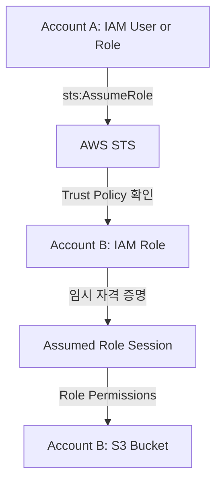

# 📘 23-04. STS AssumeRole vs Resource-Based Policies

> [!NOTE]
> **AWS SAA-C03 Study Note**  
> 핵심 키워드: `STS` · `AssumeRole` · `IAM Role` · `Trust Policy` · `Resource-Based Policy` · `Cross-Account` · `EventBridge`

## 🇰🇷 1. 두 종류의 Cross-Account 접근

다른 AWS 계정 B의 S3 버킷에 접근하려는 계정 A 사용자를 생각한다. 크게 두 가지 방법이 있다.

| 방식 | 누가 접근 권한을 설정하는가? | API 호출 시 신분 |
|---|---|---|
| **STS AssumeRole** | 계정 B의 IAM Role이 A를 신뢰하고 권한을 가짐 | **B의 Role 세션** |
| **Resource-Based Policy** | 계정 B의 S3 버킷 정책이 A의 Principal을 허용 | **A의 기존 주체** |

IAM Role은 누군가에게 영구히 권한을 이식하는 방식이 아니라, **신뢰받는 Principal이 Role의 임시 자격 증명으로 요청을 보내는 방식**이다.

## 🇰🇷 2. STS AssumeRole 동작 순서



1. **Trust Policy:** B의 Role은 A의 지정된 주체가 자신을 맡을 수 있도록 신뢰한다.
2. **Caller Authorization:** A의 주체가 `sts:AssumeRole` 호출을 허용받아야 한다. 교차 계정에서는 호출자 측 허용과 Role 측 신뢰를 함께 확인한다.
3. **STS:** 조건이 충족되면 `AccessKeyId`, `SecretAccessKey`, `SessionToken` 등 **임시 자격 증명**을 발급한다.
4. 그 자격 증명으로 호출하면 **B Role의 권한**에 따라 평가된다. A 주체의 IAM Allow가 자동 합쳐지지 않는다.

**중요:** 원래 A의 자격 증명이 삭제되거나 정지되는 건 아니다. 애플리케이션은 A의 기존 자격 증명과 B의 임시 자격 증명을 구분해 사용할 수 있다. 콘솔 Switch Role은 현재 사용 중인 세션을 변경한 것처럼 보이게 한다.

## 🇰🇷 3. Resource-Based Policy 동작 방식

B 계정 S3 버킷에 A의 Principal을 `Principal`로 지정한 Bucket Policy를 붙이면 A는 **자기 자격 증명을 유지**하면서 B의 S3에 접근할 수 있다.

- 일반적인 교차 계정 접근에서는 **A의 Identity-Based Allow + B의 Resource-Based Allow**가 모두 필요한 것으로 설계한다.
- SCP, Explicit Deny, S3 Block Public Access, KMS 키 정책 등 관련 제약도 고려한다.
- `Principal`이 명시된 정책은 **리소스 자체에 붙는 정책**이라는 점이 IAM 사용자에게 붙는 정책과 다르다.

## 🇰🇷 4. 강의의 DynamoDB → S3 사례

**목표:** A 계정 DynamoDB에서 데이터를 읽어서 B 계정 S3 버킷에 파일 업로드.

**Role 방식:** A 권한으로 DynamoDB 읽기 → B Role AssumeRole → B Role 자격 증명으로 S3 업로드. 또는 양쪽 필요한 권한을 갖춘 Role 구조를 별도로 설계한다.

**Bucket Policy 방식:** A의 원래 Principal로 A DynamoDB 읽기 + 같은 자격 증명으로 B S3 PutObject 수행 가능. 별도의 Role 전환이 없어 **이 예시에서는 편리**하다. 단 A 측 IAM 허용과 B 측 Bucket Policy 허용은 필요하다.

```text
Account A identity
   ├─ DynamoDB Scan  ──────> Account A DynamoDB
   └─ S3 PutObject   ──────> Account B S3 (Bucket Policy가 A를 허용)
```

## 🇰🇷 5. EventBridge에서의 두 권한 방식

EventBridge Rule이 대상을 호출할 때도 적절한 권한이 필요하다.

| EventBridge Rule 대상 | 일반적인 / 지원되는 권한 방법 |
|---|---|
| Lambda, SNS, SQS | Resource-Based Policy 또는 IAM Execution Role 지원. 기본/전형적인 예시는 Resource-Based Policy |
| CloudWatch Logs | Resource-Based Policy |
| EventBridge Event Bus | Resource-Based Policy |
| API Gateway | Resource-Based Policy 또는 IAM Role |
| Kinesis Data Streams | EventBridge 실행 IAM Role을 통한 Identity-Based Policy |
| ECS Task, SSM Run Command | IAM Execution Role |

예를 들어 Lambda에 `events.amazonaws.com`과 특정 Rule ARN을 허용하는 **Lambda Function Policy**가 있으면 EventBridge가 Lambda를 호출한다. Kinesis로 전송할 때는 EventBridge가 사용하는 Role에 `kinesis:PutRecord`를 허용한다.

**강의 보정:** Kinesis Data Streams 자체는 Resource-Based Policy를 지원하지만 **EventBridge Rule의 Kinesis 대상 전송은 IAM Role 방식**이다. **S3 Bucket은 일반적인 EventBridge Rule의 직접 Target 목록이 아니며**, Firehose 등 중간 서비스로 S3 적재를 구성할 수 있다.

**공식 참고:** [EventBridge Resource-Based Policies](https://docs.aws.amazon.com/eventbridge/latest/userguide/eb-use-resource-based.html), [IAM roles for EventBridge targets](https://docs.aws.amazon.com/eventbridge/latest/userguide/eb-events-iam-roles.html).

## 🎯 Exam Notes

> [!IMPORTANT]
> SAA-C03에서 구분해야 할 핵심 포인트입니다.

- AssumeRole은 **STS가 Role의 임시 자격 증명을 발급**하며, 권한이 원래 주체와 자동 합산되지 않는다.
- 교차 계정 AssumeRole: **Role Trust Policy + 호출자의 sts:AssumeRole 허용**이 핵심이다.
- Resource-Based Policy는 접근받는 리소스에 붙으며 **기존 신분을 유지**한 채 교차 계정 접근이 가능하다.
- DynamoDB(A) → S3(B) 사례에서 Bucket Policy 방식은 자격 증명 전환을 줄일 수 있다.
- EventBridge: Lambda/SNS/SQS는 리소스 정책(또는 역할), Kinesis/ECS Task는 대표적으로 실행 역할을 사용한다.

## 📝 Review Questions

> [!TIP]
> 먼저 답을 생각한 뒤 **정답 및 해설**을 펼쳐 확인하세요.

### Q1. A 계정 개발자가 B 계정 Role을 맡으려 한다. B Role에 어떤 정책, A Principal에 어떤 권한이 중요할까?

<details>
<summary>정답 및 해설 보기</summary>

**B Role Trust Policy + A 측 `sts:AssumeRole` 허용.** STS가 임시 자격 증명을 발급해 B Role 세션으로 AWS API를 호출한다.

</details>

### Q2. A 계정 사용자가 B Role을 AssumeRole한 순간 원래 IAM 사용자 권한은 정지·삭제되는가?

<details>
<summary>정답 및 해설 보기</summary>

**아니다.** 기존 자격 증명은 살아 있으며 B Role의 임시 자격 증명으로 한 요청에서 B Role 권한을 사용한다. 권한이 자동 합산되지 않는다.

</details>

### Q3. A 계정 DynamoDB를 읽고 B 계정 S3에 쓰기를 같은 Principal 자격 증명으로 처리하려면?

<details>
<summary>정답 및 해설 보기</summary>

**B의 S3 Bucket Policy로 A 주체를 허용**하고 A 측 IAM 권한도 마련한다. Role 전환이 없어 편리하다.

</details>

### Q4. EventBridge Rule이 Lambda 함수를 호출하도록 설정할 때 Lambda 측에서 EventBridge를 직접 허용하는 정책은?

<details>
<summary>정답 및 해설 보기</summary>

**Lambda Resource-Based Policy.** 특정 EventBridge Rule이 `lambda:InvokeFunction`을 호출할 수 있도록 허용한다. 최신 EventBridge에서는 IAM Execution Role 방식도 지원한다.

</details>

### Q5. Kinesis가 Resource-Based Policy를 지원하므로 EventBridge Rule도 그것만으로 Kinesis에 이벤트를 전송할까?

<details>
<summary>정답 및 해설 보기</summary>

**아니다.** EventBridge의 Kinesis Rule 대상은 IAM Role에 `kinesis:PutRecord` 등의 권한을 부여하는 방식을 사용한다.

</details>

## 🇯🇵 日本語 Summary

`sts:AssumeRole` は信頼された IAM Role の一時認証情報を取得する API。Role セッションでは元のユーザー権限と自動的に合算されない。一方、Resource-Based Policy はリソース側が指定 Principal を許可し、元の認証情報のまま利用できる。DynamoDB(A) から S3(B) にデータを保存する例では Bucket Policy が便利。EventBridge はターゲットごとに実行ロールやリソースポリシーを使い分ける。

**試験の判断:** クロスアカウントの Role 引き受けは Trust Policy、S3 直接アクセスは Bucket Policy。

## 🇺🇸 English Summary

STS AssumeRole issues temporary credentials for a trusted role. Calls made with those credentials are evaluated as the assumed role session, not as an automatic union with the original identity. Resource-based policies authorize principals directly on the target resource without a role switch. For cross-account S3 access, consider both the caller's permissions and the bucket policy. EventBridge target authorization depends on the target service.

**Exam decision:** Distinguish a temporary role session from access granted directly by a resource policy.

## 📚 Vocabulary

> GitHub 검색 시 영어 표제어 그대로 검색하면 관련 설명으로 이동하기 쉽다.

| English | 한국어 | 日本語 |
|---|---|---|
| AWS Security Token Service (STS) | AWS 임시 자격 증명 서비스 | AWS セキュリティトークンサービス |
| AssumeRole | 역할 수임 | ロール引き受け |
| Temporary Credentials | 임시 자격 증명 | 一時的な認証情報 |
| Trust Policy | 역할 신뢰 정책 | 信頼ポリシー |
| Identity-Based Policy | 자격 증명 기반 정책 | アイデンティティベースポリシー |
| Resource-Based Policy | 리소스 기반 정책 | リソースベースポリシー |
| Cross-Account Access | 계정 간 접근 | クロスアカウントアクセス |
| IAM Role Session | IAM 역할 세션 | IAM ロールセッション |
| Execution Role | 실행 역할 | 実行ロール |
| EventBridge Rule Target | 이벤트브리지 규칙 대상 | EventBridge ルールのターゲット |
