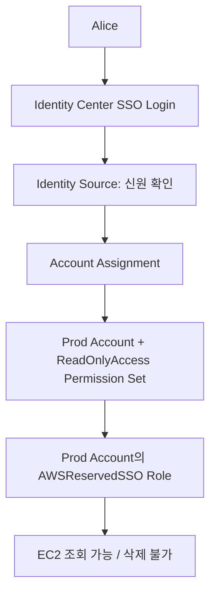

# 📘 23-06. IAM Identity Center: SSO, Permission Sets & ABAC

> [!NOTE]
> **AWS SAA-C03 Study Note**  
> 핵심 키워드: `IAM Identity Center` · `AWS Single Sign-On` · `Identity Source` · `Permission Set` · `AWSReservedSSO` · `ABAC` · `SAML` · `SCIM`

## 🇰🇷 1. IAM Identity Center = 여러 계정의 SSO

**AWS IAM Identity Center**는 이전 **AWS Single Sign-On(AWS SSO)**의 후속 명칭이다. 직원이 한 번 인증하면 **자신에게 할당된 여러 AWS 계정 및 업무 애플리케이션**으로 이동하도록 접근 포털을 제공한다.

- 조직의 개발·테스트·운영 AWS 계정은 **별도의 독립 계정으로 유지**된다.
- SSO는 **한 번 로그인하는 편의 기능**. 로그인했다고 모든 계정이나 모든 권한이 열리지는 않는다.
- Salesforce, Microsoft 365 등 SAML 2.0을 지원하는 애플리케이션과도 연계할 수 있다.

## 🇰🇷 2. Identity Source: 사용자가 누구인가?

로그인을 검증할 **사용자·그룹의 출처(Identity Source)**가 필요하다.

| 출처 | 로그인 계정 관리 위치 |
|---|---|
| Identity Center Directory | IAM Identity Center 내장 디렉터리 |
| Active Directory | 회사의 Microsoft AD / AWS Directory Service 연동 |
| External Identity Provider | Okta, Microsoft Entra ID 등 외부 IdP |

SAML 2.0은 인증 정보 교환에 쓰는 대표 표준이며 **SCIM**은 외부 IdP의 사용자·그룹 정보를 AWS와 프로비저닝/동기화할 때 활용한다. Identity Source는 **사용자의 신원을 확인**하는 역할이며, EC2 삭제 같은 AWS API 권한은 별도다.

## 🇰🇷 3. Permission Set = 계정별 권한 설계도

**Permission Set**은 **특정 AWS 계정에 로그인할 때 사용할 IAM 권한 정책들의 집합/템플릿**이다. 핵심은 **누구(User/Group) + 어느 AWS 계정 + 어떤 Permission Set**을 할당하는 것이다.

| 직원 / 그룹 | Dev Account | Test Account | Prod Account |
|---|---|---|---|
| Alice (Developer) | AdministratorAccess | ReadOnlyAccess | ReadOnlyAccess |
| Bob (Team Lead) | AdministratorAccess | AdministratorAccess | AdministratorAccess |

Alice와 Bob 둘 다 동일한 세 AWS 계정에 SSO로 로그인할 수 있어도, **각 계정에서 가능한 작업은 다를 수 있다**.

실제로 Identity Center에서 계정에 Permission Set을 할당하면 대상 AWS 계정에 그 Permission Set에 대응하는 **`AWSReservedSSO_...` IAM Role**을 생성/관리한다. 사용자는 Access Portal 또는 AWS CLI를 통해 그 Role의 권한으로 작업한다.



**정확한 적용 단위:** Permission Set은 보통 OU라는 컨테이너에 통째로 붙이는 게 아니라, **선택한 AWS 계정에 사용자/그룹과 함께 할당**한다. 대상 OU의 계정을 일괄 선택하여 관리할 수는 있다.

## 🇰🇷 4. ABAC: 사용자 속성으로 세부 권한 평가

Identity Center의 **ABAC(Attribute-Based Access Control)**는 사용자 속성(예: Department, CostCenter)을 Role 세션 태그로 전달하고 IAM Policy에서 검사하는 구조다.

```text
Alice: Department = Data
EC2:   Department = Data
IAM Condition: aws:PrincipalTag/Department == aws:ResourceTag/Department
→ 조건을 충족한다면 접근 허용 가능
```

- ABAC는 SSO의 로그인 자체를 뜻하지 않는다.
- **로그인 후 실제 AWS API 요청에 대한 조건 평가 방식**이다.
- 속성만 등록한다고 저절로 접근 제한이 생기지는 않는다. 그 속성을 평가하는 IAM 정책이 있어야 한다.

## 🇰🇷 5. AWS 계정 접근과 애플리케이션 접근

- **AWS Account Assignment:** Permission Set을 통해 AWS Account의 IAM Role 권한을 부여한다.
- **Application Assignment:** 연계된 비즈니스 애플리케이션에 어떤 User/Group이 접근할지 정의한다. AWS 계정 IAM Role을 사용하는 것과는 별개의 애플리케이션 접근 구성이다.
- Identity Center 도입의 목적은 회사의 직원 인증을 통합하면서, 계정·업무 애플리케이션별 권한은 구분하는 것이다.

**공식 참고:** [Identity Center managed roles](https://docs.aws.amazon.com/singlesignon/latest/userguide/identity-center-and-iam-roles.html), [Permission sets](https://docs.aws.amazon.com/singlesignon/latest/userguide/howtocmp.html).

## 🎯 Exam Notes

> [!IMPORTANT]
> SAA-C03에서 구분해야 할 핵심 포인트입니다.

- **여러 AWS 계정에 한 번 로그인 → IAM Identity Center(구 SSO)**.
- Identity Source = **누구인지 인증**, Permission Set = **계정에서 무엇을 할 수 있는지**.
- 할당은 **User/Group + AWS Account + Permission Set** 조합으로 생각한다.
- Identity Center가 대상 계정에 **AWSReservedSSO IAM Role**을 만들고 관리한다.
- ABAC는 로그인 후 API 권한 조건을 사용자 속성/세션 태그로 평가하는 방식이다.

## 📝 Review Questions

> [!TIP]
> 먼저 답을 생각한 뒤 **정답 및 해설**을 펼쳐 확인하세요.

### Q1. 개발자 Alice는 Dev에서 관리자, Prod에서는 읽기 전용이어야 한다. AWS 로그인 계정을 두 개 만들어야 하는가?

<details>
<summary>정답 및 해설 보기</summary>

**아니다.** 한 Identity Center 사용자에게 Dev Admin과 Prod ReadOnly Permission Set을 각각 계정별 할당한다.

</details>

### Q2. 회사에서 Okta로 직원 로그인과 사용자 정보를 관리한다. Identity Center가 연결할 구성은?

<details>
<summary>정답 및 해설 보기</summary>

**External Identity Provider(Identity Source).** SAML 2.0 인증과 필요 시 SCIM 사용자 동기화를 연동한다.

</details>

### Q3. IAM Identity Center에서 Prod Account에 ReadOnly Permission Set을 할당하면 대상 계정에 실제로 생기는 것은?

<details>
<summary>정답 및 해설 보기</summary>

**해당 Permission Set에 대응하는 `AWSReservedSSO_...` IAM Role.** 서비스가 정책/Role을 관리한다.

</details>

### Q4. Permission Set은 Dev OU 그 자체에 직접 권한을 주는 정책인가?

<details>
<summary>정답 및 해설 보기</summary>

**아니다.** User/Group과 실제 AWS Account에 대해 Permission Set을 할당한다.

</details>

### Q5. Identity Center에서 직원 Department 속성을 기록만 하면 EC2 접근이 자동 제한되는가?

<details>
<summary>정답 및 해설 보기</summary>

**아니다.** Identity Center가 속성을 Session Tag로 넘기도록 구성하고, IAM 조건에서 그 속성을 검사하는 ABAC 정책이 필요하다.

</details>

## 🇯🇵 日本語 Summary

IAM Identity Center（旧 AWS SSO）は一度のサインインで複数の AWS アカウントや業務アプリにアクセスできるようにする。Identity Source はユーザーを認証し、Permission Set は各 AWS アカウントでの権限を定義する。割り当ての単位は「User/Group + Account + Permission Set」。対象アカウントには `AWSReservedSSO_...` IAM Role が作成される。ABAC ではユーザー属性をセッションタグとしてポリシー条件に使う。

**試験の判断:** 複数アカウント SSO は IAM Identity Center。

## 🇺🇸 English Summary

IAM Identity Center provides single sign-on for workforce access to AWS accounts and business applications. Identity sources can be built-in, Microsoft AD, or external identity providers. Permission sets are assigned to user/group–account pairs and are materialized as managed IAM roles in target AWS accounts. ABAC uses user attributes and session tags in IAM conditions for fine-grained authorization.

**Exam decision:** SSO is authentication convenience; permission sets define account-specific authorization.

## 📚 Vocabulary

> GitHub 검색 시 영어 표제어 그대로 검색하면 관련 설명으로 이동하기 쉽다.

| English | 한국어 | 日本語 |
|---|---|---|
| Single Sign-On (SSO) | 통합 로그인 | シングルサインオン |
| IAM Identity Center | AWS IAM 자격 증명 센터 | IAM Identity Center |
| Identity Source | 사용자 자격 증명 출처 | アイデンティティソース |
| Identity Provider (IdP) | 자격 증명 공급자 | IDプロバイダー |
| Permission Set | 권한 세트 | 許可セット |
| Account Assignment | 계정 권한 할당 | アカウント割り当て |
| AWS Access Portal | AWS 접근 포털 | AWS アクセスポータル |
| Attribute-Based Access Control (ABAC) | 속성 기반 접근 제어 | 属性ベースアクセス制御 |
| Session Tag | 세션 태그 | セッションタグ |
| SAML 2.0 | 연합 인증 표준 | SAML 2.0 |
| SCIM | 계정 프로비저닝 표준 | SCIM |
