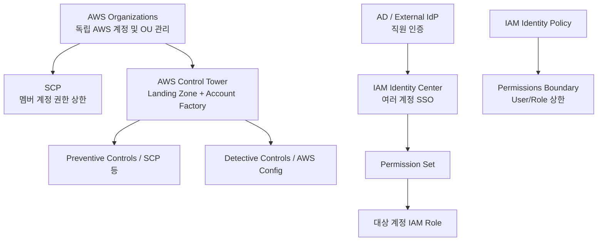

# 📘 23-09. Final Comparison: AWS Identity, Permissions & Governance

> [!NOTE]
> **AWS SAA-C03 Study Note**  
> 핵심 키워드: `Organizations vs Control Tower` · `SCP vs Permissions Boundary` · `STS AssumeRole` · `Resource-Based Policy` · `IAM Identity Center` · `Directory Service` · `Guardrails`

## 🇰🇷 1. 이번 섹션의 전체 지도



이번 섹션의 큰 주제는 **계정의 분리/관리, 접근 주체의 인증, 권한의 부여, 권한의 상한, 지속적인 보안 통제**다.

## 🇰🇷 2. 뭘 요구하면 어떤 서비스인가?

| 시험의 요구사항 | 우선 선택 | 구별 이유 |
|---|---|---|
| AWS 계정 여러 개를 묶고 청구 통합 | **Organizations** | 계정·OU 관리 기반 |
| 기본 로깅/감사/보안이 갖춰진 다중 계정 표준 환경 | **Control Tower** | Landing Zone 자동 구성 |
| 멤버 계정 전체에서 S3 사용 금지 | **SCP** | 조직·OU 단위 최대 권한 제한 |
| 특정 IAM User/Role의 권한 상한 | **Permissions Boundary** | 개별 IAM 주체의 상한 |
| 직원들이 여러 AWS 계정에 한 번 로그인 | **IAM Identity Center** | SSO |
| 직원마다 AWS 계정별 권한 다르게 지정 | **Permission Set** | 그룹+계정+권한 템플릿 할당 |
| 다른 계정의 임시 Role 권한으로 접근 | **STS AssumeRole** | 일시적 자격 증명 |
| 기존 자격 증명 유지하면서 다른 계정 S3 접근 | **S3 Bucket Policy** | 리소스에서 Principal 직접 허용 |
| 기존 온프레미스 AD에 AWS 인증 요청 전달 | **AD Connector** | 인증 프록시 |
| AWS 안에 실제 Microsoft AD 구축 | **AWS Managed Microsoft AD** | 독립된 관리형 AD |
| 위반 행위 자체를 차단 | **Preventive Control** | SCP/RCP 등 |
| 이미 구성된 리소스의 위반 탐지 | **Detective Control** | AWS Config |
| CloudFormation 배포 전 리소스 검사 | **Proactive Control** | CloudFormation Hooks |

## 🇰🇷 3. Organizations vs Control Tower vs Identity Center

- **Organizations:** AWS **계정 조직**을 관리한다.
- **Control Tower:** Organizations를 토대로 여러 계정에 **표준 보안·감사·거버넌스 환경**을 만든다.
- **Identity Center:** 직원이 **SSO로 계정을 선택**하고, 계정마다 적합한 Permission Set으로 IAM Role을 사용한다.

세 서비스는 **서로 대체하는 것이 아니라 함께 쓰는 것**이다.

## 🇰🇷 4. SCP vs Boundary vs Resource Policy

| 정책 | 어디에 연결? | 작용 |
|---|---|---|
| SCP | Organizations Root / OU / 계정 | 멤버 계정 주체의 최대 권한 제한 |
| Permissions Boundary | IAM User / Role | Identity-Based Policy로 얻는 최대 권한 제한 |
| Identity-Based Policy | IAM User / Group / Role | 해당 Principal의 AWS API 권한 허용·거부 |
| Resource-Based Policy | S3 Bucket, Lambda, SQS 등 | 리소스에 접근할 Principal 명시, 허용·거부 |
| Session Policy | STS Role 세션 등 | 해당 임시 세션 권한 범위 제한 |

**Explicit Deny는 모든 Allow보다 우선**한다. **SCP와 Boundary는 권한을 직접 주지 않는다.** Resource-Based Policy는 같은 계정의 특정 Principal 직접 허용에 관한 별도 평가 예외가 있다.

## 🇰🇷 5. AWS 계정 3개의 직원 권한 사례

```text
Organizations
├── Dev Account
├── Test Account
└── Prod Account

IAM Identity Center
├── Alice: Dev(Admin), Test(ReadOnly), Prod(ReadOnly)
└── Bob:   Dev(Admin), Test(Admin), Prod(Admin)
```

동일한 3개 계정을 접속할 수 있어도 **사용자·계정별 Permission Set이 다르므로 가능한 작업이 달라진다.**

만약 Prod OU에 `Deny ec2:TerminateInstances` SCP가 붙어 있다면 **Bob이 AdministratorAccess를 받아도 EC2 종료가 거부**된다. IAM Identity Center에서 권한을 줬다고 SCP를 우회할 수는 없다.

## 🇰🇷 6. 교차 계정 데이터 파이프라인 사례

**문제:** A 계정 DynamoDB에서 데이터를 읽고 B 계정 S3로 저장.

- **AssumeRole:** A 자격 증명으로 읽고 B Role 자격 증명으로 쓰는 방법. 서로 다른 자격 증명을 사용할 수 있고, 필요한 권한을 Role에 부여하는 변형도 가능하다.
- **Bucket Policy:** B Bucket Policy가 A의 Principal을 허용하고 A 측 Identity-Based Policy도 허용하면 **원래 자격 증명으로 A DynamoDB + B S3에 작업** 가능.
- 선택 기준은 시스템 설계와 요구 권한이며, 두 방식 모두 올바르게 구현할 수 있다.

## 🇰🇷 7. 자주 혼동하는 8가지

1. **Organizations Root ≠ Account Root User.** 이름만 같다.
2. **SCP `FullAWSAccess` ≠ IAM AdministratorAccess.** SCP Allow는 권한을 주지 않는다.
3. **AssumeRole ≠ 기존 자격 증명의 영구 삭제.** 임시 Role 세션을 사용한다.
4. **Identity Source ≠ Permission Set.** 신원 인증 vs 계정별 작업 권한.
5. **Permission Set ≠ OU 전체에 자동 적용.** 사용자/그룹+계정별 할당이다.
6. **Managed Microsoft AD ≠ AD Connector.** 새 AD 생성 vs 기존 AD에 프록시.
7. **AWS Config ≠ 사전 차단.** 위반 탐지 및 별도 교정 자동화.
8. **Control Tower ≠ Organizations 대체.** Organizations를 기반으로 표준 거버넌스를 구축한다.

## 🇰🇷 8. 강의의 오래된 부분과 최신 보정(2026-10)

- Organizations 초대 만료는 **15일**.
- EventBridge Rule의 Lambda/SNS/SQS 대상은 **Resource-Based Policy 또는 IAM Execution Role**을 사용할 수 있고, Kinesis 대상은 IAM Role 방식이다.
- AD Connector Small/Large는 **처리량 차이**이며 강제 사용자 수 제한이 없다.
- Simple AD는 **2026-07-30 이후 신규 고객에게 제공되지 않음**.
- Control Tower는 Preventive / Detective 외에 **Proactive Control**도 제공한다.

## 🎯 Exam Notes

> [!IMPORTANT]
> SAA-C03에서 구분해야 할 핵심 포인트입니다.

- 시험 문제의 **관리 대상**부터 구분한다: 계정(Organizations), 직원 로그인(Identity Center), 권한 상한(SCP/Boundary), 구성 위반(Config).
- Organizations와 Control Tower는 대체제가 아니라 **기반 서비스 vs 자동 거버넌스 구성 서비스**다.
- SSO의 1회 로그인과 계정별 Authorization은 분리되어 있으며 **Permission Set**이 핵심이다.
- IAM에서 **Explicit Deny가 우선**, SCP/Boundary Allow는 권한 자체를 주지 않는다.
- 강의의 과거 숫자·서비스 제약은 현행 AWS 문서와 비교하여 선택 기준을 확인한다.

## 📝 Review Questions

> [!TIP]
> 먼저 답을 생각한 뒤 **정답 및 해설**을 펼쳐 확인하세요.

### Q1. 회사는 40개 AWS 계정에 동일 보안 기본 설정, 중앙 로그 계정과 계정 생성 표준화를 원한다. Organizations와 Control Tower 중 어떤 것이 핵심인가?

<details>
<summary>정답 및 해설 보기</summary>

**AWS Control Tower Landing Zone + Account Factory.** Organizations를 기반으로 표준화·감사·보안 통제 구축까지 자동화한다.

</details>

### Q2. 직원 Alice는 Prod 계정의 ReadOnly Permission Set을 받았다. Prod OU에 S3 Deny SCP가 있다면 Alice가 S3를 읽을 수 있나?

<details>
<summary>정답 및 해설 보기</summary>

**읽을 수 없다.** Identity Center의 Permission Set Allow가 있어도 Prod OU의 SCP Explicit Deny가 우선한다.

</details>

### Q3. 개발자 John에게 IAM 사용자 생성 권한을 위임하되 관리자 권한으로 확대하지 못하게 하려면?

<details>
<summary>정답 및 해설 보기</summary>

**Permissions Boundary 강제.** IAM User/Role 수준 최대 권한을 설정하고 Boundary 변경/삭제 우회도 제한한다.

</details>

### Q4. 기존 온프레미스 AD 직원 계정으로 AWS 계정들에 SSO 접속하고 싶지만 AWS에 새 Microsoft AD는 만들고 싶지 않다. 어떤 조합인가?

<details>
<summary>정답 및 해설 보기</summary>

**AD Connector + IAM Identity Center.** 기존 AD로 인증을 프록시하고 Permission Set으로 계정별 권한을 제공한다.

</details>

### Q5. 회사는 금지된 리전에서 API 실행을 차단하고, 생성된 EC2에 태그가 빠졌는지 감시하며, CloudFormation 배포 전에 규칙도 검사하려 한다. 세 Control은?

<details>
<summary>정답 및 해설 보기</summary>

**Preventive / Detective / Proactive Control.** 각각 SCP 등 작업 차단, Config Rule 사후 평가, CloudFormation Hooks 배포 전 검사다.

</details>

## 🇯🇵 日本語 Summary

この章の判断軸は「AWS アカウント管理」「社員の認証」「権限付与」「権限の上限」「ガバナンス」に分かれる。Organizations はアカウントと OU、Control Tower は Landing Zone、IAM Identity Center は SSO と Permission Set、SCP は Member Account の上限、Permissions Boundary は User/Role の上限を担当する。クロスアカウントアクセスでは AssumeRole と Resource-Based Policy を区別する。

**試験の判断:** どの対象を、いつ、どの単位で制御する必要があるのかを先に見極める。

## 🇺🇸 English Summary

Choose services by scope and purpose. Organizations manages accounts and OUs; Control Tower establishes a governed landing zone; IAM Identity Center authenticates workforce users and assigns permission sets to accounts. SCPs restrict member accounts, whereas permissions boundaries restrict IAM user/role entitlements. STS AssumeRole switches to temporary role credentials; resource-based policies authorize principals on a resource. Preventive, detective, and proactive controls differ in when they act.

**Exam decision:** Identify the principal, action, resource, conditions, organizational scope, and timing of governance controls.

## 📚 Vocabulary

> GitHub 검색 시 영어 표제어 그대로 검색하면 관련 설명으로 이동하기 쉽다.

| English | 한국어 | 日本語 |
|---|---|---|
| Governance | 거버넌스·관리 통제 | ガバナンス |
| Authorization | 권한 부여·인가 | 認可 |
| Authentication | 신원 인증 | 認証 |
| Cross-Account | 계정 간 | クロスアカウント |
| Permission Ceiling | 권한 상한 | 権限の上限 |
| Identity Source | 사용자 정보 출처 | アイデンティティソース |
| Permission Set | 권한 세트 | 許可セット |
| Preventive Control | 사전 차단 제어 | 予防的コントロール |
| Detective Control | 사후 위반 탐지 제어 | 発見的コントロール |
| Proactive Control | 배포 전 검증 제어 | 事前検証コントロール |
| Explicit Deny | 명시적 거부 | 明示的な拒否 |
| Assumed Role Session | 수임 역할 세션 | 引き受けたロールセッション |
